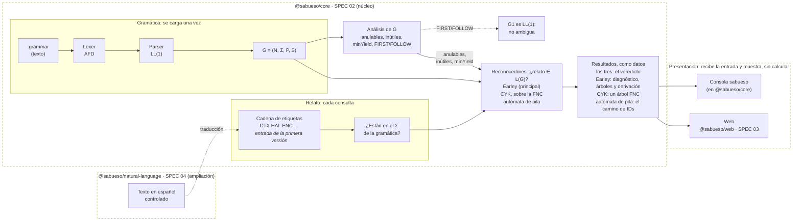

# Sabueso

**Analizador sintáctico de relatos policiales.** Decide si un relato respeta la estructura del policial de enigma, con una gramática libre de contexto y un analizador de Earley implementado desde cero.

[](https://github.com/julioale21/sabueso/actions/workflows/ci.yml)

-terminados-brightgreen>)


Laboratorio Integrador Final de **Fundamentos Teóricos de Informática** · Licenciatura en Informática · Facultad de Ingeniería · UNPSJB · 2026.

---

## Contenido

- [Qué es](#qué-es)
  - [Por qué "Sabueso"](#por-qué-sabueso)
- [El anteproyecto en resumen](#el-anteproyecto-en-resumen)
- [Cómo funciona](#cómo-funciona)
- [Decisiones de diseño](#decisiones-de-diseño)
- [Estado](#estado)
- [Cómo se desarrolló: specs](#cómo-se-desarrolló-specs)
- [Primeros pasos](#primeros-pasos)
- [Uso](#uso)
- [Conceptos de la materia en el código](#conceptos-de-la-materia-en-el-código)
- [Estructura del repositorio](#estructura-del-repositorio)
- [Comandos npm](#comandos-npm)
- [Calidad](#calidad)
- [Documentación](#documentación)
- [Uso de inteligencia artificial](#uso-de-inteligencia-artificial)
- [Autor](#autor)

---

## Qué es

Sabueso recibe un relato policial escrito como una **secuencia de etiquetas narrativas**, una por evento, y responde si es una oración del lenguaje del género:

- si el relato es válido, muestra el **árbol sintáctico** y la **derivación más a la izquierda**;
- si no lo es, informa la **posición del error** y los **símbolos esperados**;
- si la gramática es ambigua, **cuenta** todos los árboles sin construirlos y **dibuja** los primeros, para mostrar la ambigüedad.

El motor es genérico: recibe la gramática como dato, en un archivo de texto `.grammar`. Cambiar la gramática no requiere tocar el código.

**La entrada, hoy y en la versión final:**

| Versión                          | Qué escribe el usuario                                                                                                                        | Estado              |
| -------------------------------- | --------------------------------------------------------------------------------------------------------------------------------------------- | ------------------- |
| **Núcleo y web** (SPEC 02 y 03)  | La secuencia de etiquetas, una por evento: `CTX HAL ENC INT SOS PIS DSC REV CNF CAP`                                                          | Terminado           |
| **Español controlado** (SPEC 04) | El relato en español, con oraciones simples (una por evento) y un vocabulario cerrado. Sabueso lo traduce a etiquetas y se las pasa al núcleo | Ampliación opcional |

**Un ejemplo.** Este es el relato de ejemplo del anteproyecto. Cada oración cuenta un evento, y cada evento tiene su etiqueta:

| Oración                                         | Etiqueta | Evento                  |
| ----------------------------------------------- | -------- | ----------------------- |
| Lord Ashby vivía en una mansión de Kent.        | `CTX`    | contexto                |
| El mayordomo encontró el cadáver de Lord Ashby. | `HAL`    | hallazgo del crimen     |
| La viuda llamó al inspector Miller.             | `ENC`    | encargo al detective    |
| Miller interrogó a la cocinera.                 | `INT`    | interrogatorio          |
| Miller sospechó del sobrino.                    | `SOS`    | sospecha                |
| Miller encontró un pañuelo en el jardín.        | `PIS`    | pista                   |
| El sobrino tenía una coartada.                  | `DSC`    | descarte de la sospecha |
| Miller acusó a la cocinera.                     | `REV`    | revelación del culpable |
| La cocinera confesó el crimen.                  | `CNF`    | confesión               |
| La policía arrestó a la cocinera.               | `CAP`    | captura                 |

- **En el núcleo**, la persona hace esta traducción y escribe la columna de etiquetas: `CTX HAL ENC INT SOS PIS DSC REV CNF CAP`. Sabueso la analiza y la acepta.
- **Con el SPEC 04**, la persona escribe la columna de oraciones, y Sabueso arma solo la secuencia de etiquetas antes de analizarla.

El texto libre, sin restricciones de vocabulario ni de forma, queda fuera de alcance, como dice el anteproyecto.

### Por qué "Sabueso"

Esta primera versión cubre un solo género, el **relato policial de enigma**, y de ahí el nombre. Pero el motor no depende del policial: Earley, el análisis y la FNC reciben la gramática como dato, y el género es solo una entrada del catálogo.

Para sumar otro tipo de narrativa (el cuento maravilloso, la tragedia, el relato de aventuras) no hace falta tocar el motor. Alcanza con tres archivos:

| Qué agregar                | Dónde                                       | Ejemplo del policial                         |
| -------------------------- | ------------------------------------------- | -------------------------------------------- |
| Las gramáticas del género  | `packages/core/grammars/genres/<género>/`   | `genres/detective/g0.grammar` y `g1.grammar` |
| Su alfabeto de etiquetas   | `packages/core/src/genres/<género>-tags.ts` | `detective-tags.ts` (las 14 etiquetas)       |
| Una entrada en el catálogo | `packages/core/src/genres/catalog.ts`       | la entrada `detective`                       |

---

## El anteproyecto en resumen

El documento completo está en el [**anteproyecto (PDF)**](Romero%20Julio%20-%20Ante%20proyecto%20Fundamentos%20Te%C3%B3ricos%20de%20la%20informatica.pdf).

| Tema                 | Resumen                                                                                                                                                                                                                       |
| -------------------- | ----------------------------------------------------------------------------------------------------------------------------------------------------------------------------------------------------------------------------- |
| **Problema**         | El policial de enigma tiene una estructura muy estable (crimen, investigación, revelación), descripta por la narratología estructural (Propp, Todorov). Eso lo vuelve un buen dominio para las gramáticas libres de contexto. |
| **Objetivo**         | Un analizador que decida si una secuencia de etiquetas respeta esa estructura, y que muestre de forma comprensible cómo llega a la decisión.                                                                                  |
| **Alfabeto**         | 14 etiquetas narrativas, de `CTX` (contexto) a `EPI` (epílogo): `CRI` crimen, `PIS` pista, `SOS` sospecha, `REV` revelación, etc.                                                                                             |
| **Gramática**        | Dos versiones: **G0**, natural y ambigua a propósito, y **G1**, rediseñada sin ambigüedad. Compararlas es el análisis de ambigüedad que pide el enunciado.                                                                    |
| **Algoritmo**        | **Earley**, implementado desde cero: acepta cualquier gramática libre de contexto, incluso ambigua, y trabaja sobre la gramática tal como se diseñó.                                                                          |
| **Alcance**          | Un **núcleo comprometido** (carga manual de etiquetas) que cubre todo el enunciado, y una **ampliación opcional**: escribir el relato en español controlado y traducirlo a etiquetas automáticamente.                         |
| **Fuera de alcance** | Comprensión de texto libre, aprendizaje automático y otros subgéneros policiales.                                                                                                                                             |

Contenidos de la materia que aplica: gramáticas libres de contexto, derivaciones y árboles, ambigüedad, formas normales (FNC y CYK), autómatas de pila, jerarquía de Chomsky, decidibilidad y autómatas finitos.

---

## Cómo funciona

El sistema tiene tres capas (los cuadros punteados): la traducción del español (ampliación), el núcleo, que calcula todo, y la presentación (la consola y la web), que recibe lo que escribe la persona y muestra los resultados, sin calcular nada. Dentro del núcleo hay dos entradas independientes, que se encuentran en los reconocedores:

- la **gramática** (un archivo `.grammar`): se carga una vez y define el lenguaje del género;
- el **relato**: lo que se analiza en cada consulta. En la primera versión (el núcleo) el flujo arranca en la **cadena de etiquetas**, que escribe la persona. La versión final (SPEC 04) agrega una etapa delante: el relato se escribe en español controlado y el programa lo traduce a esa misma cadena. Desde ahí, el flujo es idéntico.



| Etapa                            | Entrada                     | Salida                                                   | Concepto                                                  |
| -------------------------------- | --------------------------- | -------------------------------------------------------- | --------------------------------------------------------- |
| Lexer                            | texto del `.grammar`        | tokens                                                   | autómata finito determinista                              |
| Parser                           | tokens                      | reglas                                                   | análisis descendente LL(1)                                |
| Gramática                        | reglas                      | G = (N, Σ, P, S)                                         | gramática libre de contexto                               |
| Análisis                         | G                           | anulables, inútiles, minYield, ciclos, FIRST/FOLLOW      | algoritmos de punto fijo                                  |
| Traducción (SPEC 04, ampliación) | texto en español controlado | etiquetas                                                | autómatas finitos y Earley sobre una gramática de oración |
| Relato                           | etiquetas                   | etiquetas verificadas contra Σ                           | alfabeto y cadena                                         |
| Earley                           | G y el relato               | aceptado o rechazado, con diagnóstico                    | pertenencia en una GLC                                    |
| Árboles                          | el chart de Earley          | árboles, cantidad y derivación                           | árboles de derivación                                     |
| FNC                              | G                           | la misma L(G) en Forma Normal de Chomsky                 | formas normales                                           |
| CYK                              | la FNC y el relato          | aceptado o rechazado, y un árbol FNC                     | programación dinámica                                     |
| Autómata de pila                 | G y el relato               | aceptado o rechazado, con el camino de IDs               | equivalencia GLC ↔ AP                                     |
| Búsquedas acotadas               | G (o G y H) y un largo k    | las oraciones, un testigo de ambigüedad o una diferencia | semidecisión de problemas indecidibles                    |

**Para qué sirve el análisis:** los anulables los usan Earley (el arreglo de ε), los árboles y el paso DEL de la FNC; los inútiles, el paso USELESS; minYield, la poda del autómata de pila. FIRST/FOLLOW y la tabla LL(1) no alimentan a ningún algoritmo: **validan** la gramática. Si la tabla no tiene conflictos, la gramática es LL(1) y por lo tanto no ambigua. Así se demuestra que G1 no es ambigua (G0 tiene 13 conflictos).

El detalle de cada pieza, con sus funciones clave, está en la [documentación del núcleo](docs/documentation/sabueso-es.md).

---

## Decisiones de diseño

- **Earley como analizador principal.** Acepta cualquier gramática libre de contexto, incluida G0, que es ambigua, y sus árboles tienen la forma de la gramática diseñada.
- **CYK solo como comparación.** Exige pasar la gramática a Forma Normal de Chomsky, y eso deforma los árboles: aparecen símbolos como `T_a` y `X1` que nadie diseñó. Se implementa igual, para mostrar esa diferencia y para validar Earley.
- **Ningún analizador determinista para el relato.** LL y LR no sirven porque G0 es ambigua por diseño.
- **Desde cero.** No se usan bibliotecas de análisis sintáctico ni de procesamiento de lenguaje natural.
- **Las gramáticas son datos.** Se escriben en un formato propio, `.grammar`, que se lee con un lexer AFD y un parser LL(1) hechos para el proyecto. El propio formato está descripto por una gramática (`meta.grammar`).
- **G1 es LL(1).** Su tabla predictiva no tiene conflictos, y eso demuestra por construcción que no es ambigua. G0 tiene 13 conflictos.
- **El arreglo de ε de Aycock y Horspool.** El Earley clásico falla con producciones vacías. El motor incluye el arreglo, y la consola puede mostrar el error original (`--no-epsilon-fix`).
- **Resultados como datos, no callbacks.** Las trazas (del AFD, del parser y de Earley) y las rondas de los puntos fijos se devuelven como listas, listas para mostrar en la consola o en la web.
- **Un núcleo independiente de la interfaz.** Solo la entrada de la consola usa APIs de Node, así que el mismo código corre en el navegador.
- **Cada concepto tiene su comando y su prueba.** Todo lo que hace el motor se puede ver por consola.
- **Código en inglés, documentación en español.**

---

## Estado

**El núcleo está terminado (SPEC 02, los 30 pasos).** El núcleo:

- lee gramáticas `.grammar` y trae las del policial: G0 y G1;
- analiza la gramática: anulables, longitud mínima, símbolos inútiles, ciclos, FIRST/FOLLOW y tabla LL(1);
- decide con Earley si un relato pertenece al lenguaje, explica el rechazo, cuenta y dibuja los árboles y escribe la derivación;
- convierte cualquier gramática a Forma Normal de Chomsky en seis pasos;
- reconoce con CYK sobre la FNC y compara su árbol con el de Earley;
- construye el autómata de pila de la gramática y lo simula, con el camino de aceptación;
- busca testigos de ambigüedad y diferencias entre dos lenguajes hasta un largo k (semidecisión);
- verifica que sus tres reconocedores aceptan lo mismo sobre todas las cadenas cortas, y mide su rendimiento.

**La interfaz web está terminada (SPEC 03)** y publicada en [julioale21.github.io/sabueso](https://julioale21.github.io/sabueso/): el análisis de un relato con su árbol, su derivación y su diagnóstico, y una vista por concepto (Earley paso a paso, FNC y CYK, autómata de pila, LL(1) y G0 vs G1).

**Sigue, como ampliación opcional:** el relato en español controlado (SPEC 04).

El proyecto avanza por specs: ver [Cómo se desarrolló: specs](#cómo-se-desarrolló-specs).

---

## Cómo se desarrolló: specs

El proyecto se desarrolló **guiado por specs** (_spec-driven development_). Antes de escribir código, cada etapa se describe en un **spec**: un documento corto en `specs/` que dice qué se construye, qué queda afuera, el plan en pasos y cómo se verifica que está terminado. El código sigue al spec, y no al revés.

Cada spec tiene estas partes:

- **Objetivo:** una sola oración. Si no entra en una oración, el spec es demasiado grande y se divide.
- **Alcance:** lo que entra y, sobre todo, lo que **no** entra.
- **Plan de implementación:** pasos numerados; cada uno deja el sistema funcionando.
- **Criterios de aceptación:** una lista que se puede verificar, sin frases como "que funcione bien".
- **Decisiones tomadas y descartadas:** el porqué de cada elección, que es lo que más vale con el tiempo.

**El ciclo de un spec:**

1. **Escribir.** Se plantea la etapa y se responden las preguntas abiertas (alcance, datos, riesgos) antes de redactar. El spec queda en estado _Borrador_.
2. **Revisar y aprobar.** El autor lo relee y lo cambia a _Aprobado_. Solo un spec aprobado se implementa.
3. **Implementar.** En una rama propia, paso por paso, en el orden del plan. Si aparece algo que el spec no resuelve, se decide y se anota en el spec, no en el código por sorpresa.
4. **Verificar.** Se revisan los criterios de aceptación uno por uno (pruebas, chequeos, la salida de la consola o de la web).
5. **Cerrar.** El spec pasa a _Implementado_ (o _Terminado_), se agrega una nota de cierre y la rama se integra a `main`.

| Spec                                                            | Contenido                                                                      | Estado               |
| --------------------------------------------------------------- | ------------------------------------------------------------------------------ | -------------------- |
| [01 — Setup del proyecto](specs/01-project-setup.md)            | Monorepo, tooling, esqueletos y CLI base                                       | Terminado            |
| [02 — Núcleo y motor de Earley](specs/02-core-earley-engine.md) | Librería de gramáticas y analizador de Earley (`@sabueso/core`)                | Terminado (30 pasos) |
| [03 — Interfaz web](specs/03-web-interface.md)                  | Análisis visual y vistas didácticas (`apps/web`)                               | Terminado            |
| [04 — Español controlado](specs/04-controlled-spanish.md)       | Del texto del relato a la secuencia de etiquetas (`@sabueso/natural-language`) | Borrador             |
| [05 — Arreglos del núcleo](specs/05-core-review-fixes.md)       | Lo que encontró la revisión de código del núcleo                               | Implementado         |
| [06 — Arreglos de la web](specs/06-web-review-fixes.md)         | Lo que encontró la revisión de código de la web                                | Implementado         |
| [07 — Una sola guía por tema](specs/07-docs-merge.md)           | Fichas y guías fusionadas, en español y sin repetir                            | En curso             |

---

## Primeros pasos

**Requisitos:** Node.js 24 (la versión de `.nvmrc`; la mínima soportada es 20.19) y npm.

```sh
git clone https://github.com/julioale21/sabueso.git
cd sabueso
nvm use          # Node 24, según .nvmrc
npm install      # instala dependencias y activa los hooks de git
npm test         # corre todas las pruebas
```

`npm install` activa los hooks de git con el script `prepare`. Si creaste el repositorio con `git init` después de instalar, vuelve a correr `npm install`.

---

## Uso

Todo el motor se usa por consola con `npm run sabueso -- <comando>`. `npm run sabueso -- help` lista los comandos.

```sh
npm run sabueso -- genres                                     # el policial de enigma y sus 14 etiquetas
npm run sabueso -- grammar g1                                 # G1 completa: G = (N, Σ, P, S)
npm run sabueso -- analyze --grammar g1                       # todos los análisis de G1
npm run sabueso -- parse --grammar g1 "CRI PIS REV"           # veredicto, árbol y derivación
npm run sabueso -- parse --grammar g1 "CRI REV"               # rechazo: posición y esperados
npm run sabueso -- earley --grammar g1 --chart "CRI PIS REV"  # los conjuntos de Earley S0 … S3
npm run sabueso -- count --grammar g0 "CRI SOS PIS INT REV"   # 4 árboles: G0 es ambigua
npm run sabueso -- count --grammar g1 "CRI SOS PIS INT REV"   # 1 árbol: G1 no lo es
npm run sabueso -- chomsky-normal-form --grammar g1           # los 6 pasos de la FNC
npm run sabueso -- cocke-younger-kasami --grammar g1 --compare "CRI PIS REV"   # CYK junto a Earley
npm run sabueso -- pushdown-automaton --grammar g1 "CRI PIS REV"              # el autómata de pila, ID por ID
npm run sabueso -- ambiguity --grammar g0 --max-length 4      # el relato más corto con 2 árboles
npm run sabueso -- compare g0 g1 --max-length 3               # lo que acepta G0 y no G1
```

Las gramáticas incluidas son las del género (`g0` y `g1`), la del formato (`meta`) y siete de prueba (`arithmetic`, `parentheses`, `epsilon-trap`, …). `npm run sabueso -- grammars` las lista. Para usar una gramática propia: `--grammar-file <ruta>`.

El recorrido completo de la demo está en [`docs/demo-consola.md`](docs/demo-consola.md).

### La interfaz web

- **En línea:** [julioale21.github.io/sabueso](https://julioale21.github.io/sabueso/). Se publica sola en cada push a `main`.
- **En local:** `npm run dev -w @sabueso/web` y abre la dirección que muestra la consola.

Para publicarla en un fork:

1. El repositorio tiene que ser público (o tener un plan que permita Pages en repositorios privados).
2. En **Settings → Pages → Build and deployment → Source**, elige **GitHub Actions**.
3. Haz push a `main`: el workflow [`deploy-pages.yml`](.github/workflows/deploy-pages.yml) corre las pruebas, compila la web con `VITE_BASE=/<repositorio>/` y la publica. Si el repositorio no se llama `sabueso`, cambia `VITE_BASE` en el workflow.

---

## Conceptos de la materia en el código

Cada concepto tiene su guía (con la teoría primero y después el código), un lugar en el código y un comando de consola que lo muestra. Las guías 30 y 31 no tienen código propio: ubican en la teoría lo que el resto ya hace.

| #   | Concepto                                     | Código (`packages/core/src/`)                                           | Guía                                                        | Comando (`npm run sabueso -- …`)                               |
| --- | -------------------------------------------- | ----------------------------------------------------------------------- | ----------------------------------------------------------- | -------------------------------------------------------------- |
| 01  | Alfabeto, cadena y lenguaje                  | `input/sequence.ts`                                                     | [guía 06](docs/guides/06-relato-como-cadena.md)             | `tokens --grammar g1 "CRI XYZ REV"`                            |
| 02  | Gramática libre de contexto G = (N, Σ, P, S) | `grammar/build.ts`                                                      | [guía 02](docs/guides/02-gramatica-libre-de-contexto.md)    | `grammar g1`                                                   |
| 03  | Autómata finito determinista (lexer)         | `automata/deterministic-finite-automaton.ts`, `grammar-format/lexer.ts` | [guía 03](docs/guides/03-lexer-afd.md)                      | `lex g1 --states`                                              |
| 04  | Análisis descendente predictivo              | `grammar-format/parser.ts`                                              | [guía 04](docs/guides/04-parser-ll1.md)                     | `grammar arithmetic --parser-trace`                            |
| 05  | FIRST y FOLLOW (punto fijo)                  | `analysis/first-follow.ts`                                              | [guía 11](docs/guides/11-first-y-follow.md)                 | `first-follow --grammar g1 --steps`                            |
| 06  | Tabla LL(1): LL(1) ⇒ no ambigua              | `analysis/predictive-table.ts`                                          | [guía 12](docs/guides/12-tabla-ll1-y-no-ambiguedad.md)      | `predictive-table --grammar g1`                                |
| 07  | Símbolos anulables                           | `analysis/nullable.ts`                                                  | [guía 07](docs/guides/07-simbolos-anulables.md)             | `nullable --grammar g1 --steps`                                |
| 08  | Símbolos inútiles y vacuidad                 | `analysis/useful.ts`                                                    | [guía 09](docs/guides/09-simbolos-inutiles-y-vacuidad.md)   | `useful --grammar test-useless --steps`                        |
| 09  | Ciclos A ⇒+ A                                | `analysis/cycles.ts`                                                    | [guía 10](docs/guides/10-ciclos.md)                         | `cycles --grammar test-cyclic --graph`                         |
| 10  | Longitud mínima derivable                    | `analysis/min-yield.ts`                                                 | [guía 08](docs/guides/08-longitud-minima-derivable.md)      | `min-yield --grammar g1`                                       |
| 11  | Ítem de Earley (regla punteada)              | `earley/item.ts`                                                        | [guía 13](docs/guides/13-earley-items-y-conjuntos.md)       | `items --grammar parentheses`                                  |
| 12  | Conjuntos de Earley (chart)                  | `earley/chart.ts`                                                       | [guía 13](docs/guides/13-earley-items-y-conjuntos.md)       | `earley --grammar g1 --chart "CRI PIS REV"`                    |
| 13  | Predictor                                    | `earley/recognizer.ts`                                                  | [guía 14](docs/guides/14-reconocedor-de-earley.md)          | `trace --grammar g1 "CRI PIS REV"`                             |
| 14  | Scanner                                      | `earley/recognizer.ts`                                                  | [guía 14](docs/guides/14-reconocedor-de-earley.md)          | `trace --grammar g1 "CRI PIS REV"`                             |
| 15  | Completer                                    | `earley/recognizer.ts`                                                  | [guía 14](docs/guides/14-reconocedor-de-earley.md)          | `trace --grammar g1 "CRI PIS REV"`                             |
| 16  | El arreglo de ε (Aycock y Horspool)          | `earley/recognizer.ts`                                                  | [guía 15](docs/guides/15-arreglo-de-epsilon.md)             | `earley --grammar epsilon-trap --chart --no-epsilon-fix "x"`   |
| 17  | Aceptación y diagnóstico de errores          | `earley/diagnostics.ts`                                                 | [guía 16](docs/guides/16-diagnostico-de-errores.md)         | `earley --grammar g0 "CRI REV"`                                |
| 18  | Árboles de derivación (enlaces)              | `trees/enumerate.ts`                                                    | [guía 19](docs/guides/19-arboles-de-un-relato.md)           | `trees --grammar g0 "CRI SOS PIS INT REV"`                     |
| 19  | Conteo de árboles (Catalan)                  | `trees/count.ts`                                                        | [guía 20](docs/guides/20-conteo-de-arboles.md)              | `count --grammar g0 --file packages/core/test/fixtures/l1.txt` |
| 20  | Derivación más a la izquierda                | `trees/derivation.ts`                                                   | [guía 21](docs/guides/21-derivacion-mas-a-la-izquierda.md)  | `derive --grammar g1 "CRI SOS PIS INT REV"`                    |
| 21  | Ambigüedad: G0 contra G1                     | `packages/core/grammars/genres/detective/`                              | [guía 19](docs/guides/19-arboles-de-un-relato.md)           | `count --grammar g0 "CRI SOS PIS INT REV"`                     |
| 22  | Forma Normal de Chomsky                      | `chomsky-normal-form/`                                                  | [guía 23](docs/guides/23-fnc-start-del-unit.md)             | `chomsky-normal-form --grammar g1`                             |
| 23  | CYK                                          | `cocke-younger-kasami/recognizer.ts`                                    | [guía 25](docs/guides/25-cyk.md)                            | `cocke-younger-kasami --grammar g1 --compare "CRI PIS REV"`    |
| 24  | Autómata de pila (GLC → AP)                  | `pushdown-automaton/`                                                   | [guía 26](docs/guides/26-automata-de-pila.md)               | `pushdown-automaton --grammar g1 "CRI PIS REV"`                |
| 25  | Búsquedas acotadas (semidecisión)            | `bounded/`                                                              | [guía 27](docs/guides/27-busquedas-acotadas.md)             | `ambiguity --grammar g0 --max-length 4`                        |
| 26  | Jerarquía de Chomsky y límites de las GLC    | (sin código propio)                                                     | [guía 30](docs/guides/30-jerarquia-de-chomsky-y-limites.md) | `pushdown-automaton --grammar parentheses "( ( ) )"`           |
| 27  | Decidibilidad y máquina de Turing            | (sin código propio)                                                     | [guía 31](docs/guides/31-decidibilidad-y-turing.md)         | `compare g0 g1 --max-length 3`                                 |

---

## Estructura del repositorio

```plaintext
sabueso/
├── packages/
│   └── core/                          # @sabueso/core: el motor, sus pruebas y la consola
│       ├── grammars/
│       │   ├── genres/detective/      # G0 (ambigua) y G1 (oficial) del policial
│       │   ├── test/                  # gramáticas de libro y casos borde
│       │   └── meta.grammar           # la gramática del propio formato .grammar
│       ├── src/
│       │   ├── grammar/               # el modelo G = (N, Σ, P, S) y buildGrammar
│       │   ├── automata/              # el ejecutor genérico de AFD
│       │   ├── grammar-format/        # lexer (AFD) y parser LL(1) del formato .grammar
│       │   ├── input/                 # el relato: separar etiquetas y verificar Σ
│       │   ├── analysis/              # anulables, minYield, inútiles, ciclos, FIRST/FOLLOW, LL(1)
│       │   ├── earley/                # ítems, chart, reconocedor, diagnóstico y traza
│       │   ├── trees/                 # árboles, árboles ε, conteo, derivación y dibujo
│       │   ├── chomsky-normal-form/   # los 6 pasos de la FNC
│       │   ├── cocke-younger-kasami/  # CYK sobre la FNC
│       │   ├── pushdown-automaton/    # GLC → autómata de pila y su simulación
│       │   ├── bounded/               # búsquedas acotadas: generar, testigo, comparar
│       │   ├── differential/          # los tres reconocedores sobre el mismo corpus
│       │   ├── performance/           # el tiempo de cada etapa de un análisis
│       │   ├── genres/                # catálogo de géneros y sus etiquetas
│       │   ├── command-line/          # la consola sabueso: un archivo por comando
│       │   ├── parse.ts               # parse(): la API que usa la web
│       │   ├── index.ts               # la API pública del paquete
│       │   └── command-line.ts        # punto de entrada de la consola
│       └── test/                      # las pruebas, organizadas como src (más integración)
├── apps/
│   └── web/                           # @sabueso/web: la interfaz web (Vite + React)
├── docs/
│   ├── documentation/                 # documentación del núcleo (sabueso-es.md y su PDF)
│   ├── guides/                        # una guía por paso del SPEC 02, y la 29 de la web
│   ├── interactive/                   # páginas paso a paso: Earley y el autómata de pila
│   └── demo-consola.md                # los comandos de la demo, en orden
├── examples/grammars/                 # gramáticas chicas para mostrar casos por consola
├── specs/                             # los specs del proyecto, uno por etapa
├── .github/workflows/ci.yml           # integración continua
├── .githooks/                         # pre-commit y pre-push
└── Romero Julio - Ante proyecto …pdf  # el anteproyecto
```

## Comandos npm

| Comando                                   | Qué hace                                  |
| ----------------------------------------- | ----------------------------------------- |
| `npm run sabueso -- <comando>`            | Compila el núcleo y ejecuta su consola    |
| `npm run dev -w @sabueso/web`             | Servidor de desarrollo de la interfaz web |
| `npm test`                                | Pruebas del núcleo y de la web (Vitest)   |
| `npm run build`                           | Compila `core` y genera `apps/web/dist`   |
| `npm run typecheck`                       | Verifica los tipos del núcleo y de la web |
| `npm run lint`                            | ESLint                                    |
| `npm run format` / `npm run format:check` | Aplica o verifica el formato de Prettier  |

---

## Calidad

- **Pruebas:** más de 900 pruebas con Vitest, con valores calculados a mano. Cada comando de consola tiene la suya, y una prueba verifica que el guion de la demo sigue funcionando.
- **Prueba diferencial:** Earley, CYK y el autómata de pila aceptan exactamente las mismas cadenas, sobre todas las cadenas de G0 y G1 hasta largo 4 (41 371 cada una): 0 discrepancias. `npm run sabueso -- differential --grammar g1 --max-length 4`.
- **Rendimiento:** G1 analiza un relato de 200 eventos en unos 24 ms; el anteproyecto pide menos de un segundo. `npm run sabueso -- bench --grammar g1 --file packages/core/test/fixtures/l1.txt`.
- **Hooks de git** (`.githooks/`): `pre-commit` corre `format:check` y `lint`; `pre-push` corre `npm test`.
- **Integración continua** (`.github/workflows/ci.yml`): en cada push y pull request corre `npm ci`, `format:check`, `lint`, `typecheck`, `build` y `test`.
- **TypeScript estricto**, con `exactOptionalPropertyTypes`.

---

## Documentación

| Documento                                                                                                      | Para qué                                                 |
| -------------------------------------------------------------------------------------------------------------- | -------------------------------------------------------- |
| [Documentación del núcleo y la web](docs/documentation/sabueso-es.md)                                          | Arquitectura, piezas, funciones clave y cómo se conectan |
| [Core and web documentation (English)](docs/documentation/sabueso-en.md)                                       | La misma documentación, en inglés                        |
| [Guías de estudio](docs/guides/)                                                                               | La teoría y el código de cada tema, y la web (29)        |
| [Demo por consola](docs/demo-consola.md)                                                                       | Los comandos de la exposición, en orden                  |
| [Verificación manual de la web](docs/verificacion-manual-web.md)                                               | La lista para revisar la web a mano, vista por vista     |
| [Specs](specs/)                                                                                                | Qué se construye en cada etapa y por qué                 |
| [Anteproyecto](Romero%20Julio%20-%20Ante%20proyecto%20Fundamentos%20Te%C3%B3ricos%20de%20la%20informatica.pdf) | La propuesta original del trabajo                        |

---

## Uso de inteligencia artificial

Como anticipa el anteproyecto, el trabajo usa asistentes de inteligencia artificial como apoyo, dentro de la política de la cátedra, y su uso se declara acá.

- **Herramienta:** Claude (Anthropic), a través de Claude Code.
- **Para qué se usó:** discutir alternativas de diseño, redactar los specs, escribir y revisar el código y las pruebas, y redactar la documentación (las guías y este README).
- **Qué hizo el autor:** definió el problema, el modelo narrativo, las etiquetas y las gramáticas G0 y G1 del anteproyecto; decidió el alcance y las decisiones de diseño; guió el desarrollo paso a paso y revisó y aprobó cada cambio. Los valores esperados de las pruebas se calcularon a mano en los specs antes de implementar.
- **Revisión:** el autor revisó el trabajo y asume el contenido del repositorio como propio.

---

## Autor

**Julio Alejandro Romero**

- Asignatura: Fundamentos Teóricos de Informática, 2026
- Carrera: Licenciatura en Informática, Facultad de Ingeniería, UNPSJB
- Docente: Lic. Daniel Isaías Arza
- Modalidad: individual
