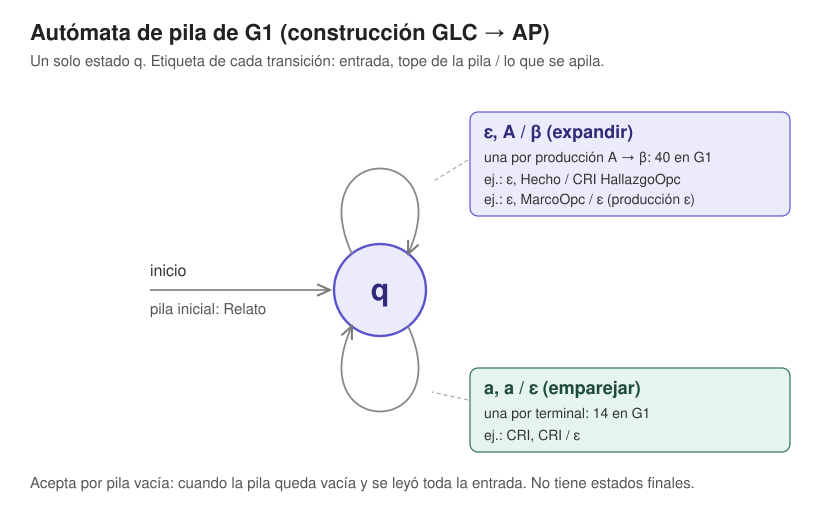

# 24 — Autómata de pila (GLC → AP)

> **Borrador adelantado.** El código llega en el paso 26 (`packages/core/src/pushdown-automaton/`). Esta ficha ya muestra el autómata de G1 y una corrida completa, calculadas a partir de `g1.grammar`.

## 1. Definición formal

- Un **autómata de pila** (AP) es P = (Q, Σ, Γ, δ, q₀, Z₀, F): un autómata finito con una pila. Cada transición lee un símbolo de la entrada **o ninguno** (ε), mira el **tope** de la pila, lo reemplaza por una cadena de Γ\* y cambia de estado. Es **no determinista**: puede haber varias transiciones posibles.
- Una **descripción instantánea** (ID) es la foto de un momento: (estado, entrada que falta leer, contenido de la pila). Un paso se escribe ⊢.
- **Aceptación por pila vacía:** w ∈ N(P) si (q₀, w, Z₀) ⊢\* (q, ε, ε).
- **Teorema (Hopcroft 6.3.1):** para toda GLC G hay un AP P con N(P) = L(G). Los AP reconocen exactamente los lenguajes libres de contexto (tipo 2 de Chomsky), igual que los AFD reconocen exactamente los regulares (tipo 3).

**La construcción** usa un solo estado: P = ({q}, Σ, N ∪ Σ, δ, q, S), con dos tipos de transición:

| Tipo          | Transición                           | Qué hace                                                                                                      | En G1 |
| ------------- | ------------------------------------ | ------------------------------------------------------------------------------------------------------------- | ----- |
| **Expandir**  | δ(q, ε, A) ∋ (q, β) por cada A → β   | si el tope es un no terminal A, lo reemplaza por el lado derecho de una de sus producciones, sin leer entrada | 40    |
| **Emparejar** | δ(q, a, a) = {(q, ε)} por cada a ∈ Σ | si el tope es el terminal a y la entrada sigue con a, lo saca y avanza                                        | 14    |

La pila guarda **lo que falta derivar**. El autómata adivina (no determinismo) qué producción usar en cada expansión; si adivina mal, esa rama no llega a pila vacía.

## 2. Ejemplo resuelto a mano: `CRI PIS REV` con G1

Cada fila es una ID. El tope de la pila está a la izquierda. Los números entre paréntesis son los de `npm run sabueso -- grammar g1`.

| Paso | Entrada que falta | Pila                                             | Transición usada                                      |
| ---- | ----------------- | ------------------------------------------------ | ----------------------------------------------------- |
| 0    | CRI PIS REV       | Relato                                           | — (configuración inicial)                             |
| 1    | CRI PIS REV       | Planteo Investigacion Desenlace                  | expandir (0) Relato → Planteo Investigacion Desenlace |
| 2    | CRI PIS REV       | Hecho MarcoOpc Investigacion Desenlace           | expandir (1) Planteo → Hecho MarcoOpc                 |
| 3    | CRI PIS REV       | CRI HallazgoOpc MarcoOpc Investigacion Desenlace | expandir (11) Hecho → CRI HallazgoOpc                 |
| 4    | PIS REV           | HallazgoOpc MarcoOpc Investigacion Desenlace     | emparejar CRI                                         |
| 5    | PIS REV           | MarcoOpc Investigacion Desenlace                 | expandir (14) HallazgoOpc → ε                         |
| 6    | PIS REV           | Investigacion Desenlace                          | expandir (4) MarcoOpc → ε                             |
| 7    | PIS REV           | Pasos Desenlace                                  | expandir (15) Investigacion → Pasos                   |
| 8    | PIS REV           | Evidencia Libres Lineas Desenlace                | expandir (17) Pasos → Evidencia Libres Lineas         |
| 9    | PIS REV           | PIS Libres Lineas Desenlace                      | expandir (28) Evidencia → PIS                         |
| 10   | REV               | Libres Lineas Desenlace                          | emparejar PIS                                         |
| 11   | REV               | Lineas Desenlace                                 | expandir (20) Libres → ε                              |
| 12   | REV               | Desenlace                                        | expandir (22) Lineas → ε                              |
| 13   | REV               | Resolucion EpiOpc                                | expandir (31) Desenlace → Resolucion EpiOpc           |
| 14   | REV               | REV Cierre EpiOpc                                | expandir (34) Resolucion → REV Cierre                 |
| 15   | ε                 | Cierre EpiOpc                                    | emparejar REV                                         |
| 16   | ε                 | EpiOpc                                           | expandir (37) Cierre → ε                              |
| 17   | ε                 | ε                                                | expandir (33) EpiOpc → ε — **pila vacía: acepta**     |

**Qué mirar:**

- Hay 14 expansiones y 3 emparejamientos, uno por evento del relato.
- Las expansiones, leídas en orden, son exactamente la **derivación más a la izquierda** de `CRI PIS REV`: siempre se expande el no terminal de más a la izquierda, que es el tope de la pila. Es el teorema que el paso 26 verifica en código.
- En cada ID, "lo ya leído" seguido de "la pila" es una **forma sentencial** de esa derivación. Por ejemplo, en el paso 10: `CRI PIS` + `Libres Lineas Desenlace`.
- Las producciones ε (pasos 5, 6, 11, 12, 16 y 17) solo sacan el tope: son los anulables del paso 7.
- **Dónde está el no determinismo:** en el paso 1 la pila tiene `Planteo`, que tiene dos producciones (`Hecho MarcoOpc` y `Marco Hecho`). El autómata elige `Hecho MarcoOpc`; la otra rama muere, porque `Marco` no puede empezar con `CRI`. Como G1 es LL(1), mirar el próximo evento alcanza para elegir siempre bien, y el camino de aceptación es único.

Para recorrerlo paso a paso, con la pila dibujada, las transiciones posibles en cada momento y la derivación que se va formando, abrir [`docs/interactive/pushdown-automaton-g1.html`](../interactive/pushdown-automaton-g1.html) en el navegador. Incluye también A1 (`CRI SOS PIS INT REV`).

## 3. Dónde está en el código

| Qué                 | Dónde                                                                                                                                     |
| ------------------- | ----------------------------------------------------------------------------------------------------------------------------------------- |
| Construcción        | Pendiente (paso 26): `packages/core/src/pushdown-automaton/build.ts`                                                                      |
| Simulación          | Pendiente (paso 26): `pushdown-automaton/simulate.ts`, búsqueda en anchura sobre IDs, con poda por minYield (paso 8)                      |
| Comando de consola  | Pendiente (paso 26): `npm run sabueso -- pushdown-automaton --grammar g1 "CRI PIS REV"` imprime esta tabla de IDs                         |
| Relación con Earley | Un ítem de Earley A → α • β, j es un pedazo de pila compartido: Earley simula **todas** las pilas del AP a la vez (sección 3.15 del spec) |

## 4. Qué prueba lo verifica

| Prueba                        | Qué verifica                                                                                               |
| ----------------------------- | ---------------------------------------------------------------------------------------------------------- |
| Pendiente (paso 26), caso P1  | `( ( ) ) ( )` con `parentheses` se acepta                                                                  |
| Pendiente (paso 26), caso AP1 | A1 con G1 se acepta y las expansiones del camino coinciden, en orden, con su derivación más a la izquierda |

## 5. Referencia bibliográfica

- Hopcroft, Motwani y Ullman, _Introducción a la teoría de autómatas, lenguajes y computación_, secciones 6.1 a 6.3 (en particular 6.3.1, de gramáticas a autómatas de pila).
- Augusto, secciones 2.5 y 2.6.
