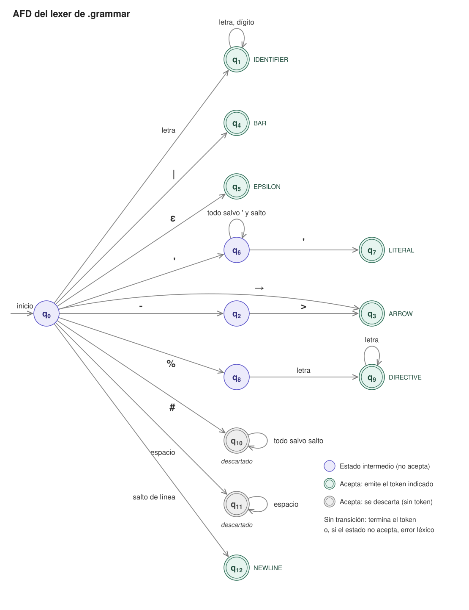

# Guía de estudio: el lexer del formato `.grammar` como AFD

> **Paso 3 del SPEC 02.** Archivos: `packages/core/src/automata/deterministic-finite-automaton.ts`, `packages/core/src/grammar-format/lexer.ts`, `packages/core/src/command-line/grammars.ts`, `packages/core/src/command-line/commands/lex.ts` y `packages/core/grammars/test/arithmetic.grammar`.
> Ficha teórica relacionada: [`docs/concepts/03-finite-automaton-lexer.md`](../concepts/03-finite-automaton-lexer.md).
>
> El autómata se diseñó primero (secciones 3 a 6) y el código reproduce exactamente ese grafo y esa tabla. Una prueba verifica que la tabla del código coincide con la de esta guía.

---

## 1. El problema que resuelve

`buildGrammar` (paso 2) recibe las reglas ya armadas en código. Para leer un archivo `.grammar`, primero hay que cortar el texto en **tokens**, las "palabras" del formato. Esa es la tarea del lexer:

```
E -> E '+' T | T
```

| Token         | Texto | Línea:columna |
| ------------- | ----- | ------------- |
| `IDENTIFIER`  | `E`   | 1:1           |
| `ARROW`       | `->`  | 1:3           |
| `IDENTIFIER`  | `E`   | 1:6           |
| `LITERAL`     | `+`   | 1:8           |
| `IDENTIFIER`  | `T`   | 1:12          |
| `BAR`         | `\|`  | 1:14          |
| `IDENTIFIER`  | `T`   | 1:16          |
| `NEWLINE`     |       | 1:17          |
| `END_OF_FILE` |       | 1:17          |

Los espacios y los comentarios no producen tokens. Después, el parser (paso 4) lee esta secuencia de tokens, no los caracteres.

| #   | Etapa           | Entrada                  | Salida          | Paso  | Estado        |
| --- | --------------- | ------------------------ | --------------- | ----- | ------------- |
| 1   | **Lexer (AFD)** | **texto del `.grammar`** | **tokens**      | **3** | **este paso** |
| 2   | Parser (LL(1))  | tokens                   | `GrammarRule[]` | 4     | pendiente     |
| 3   | `buildGrammar`  | `GrammarRule[]`          | `Grammar`       | 2     | ✅ hecho      |

---

## 2. Por qué un AFD

**Los tokens forman un lenguaje regular.** Para decidir si un carácter continúa el token actual o lo termina, alcanza con recordar **en qué parte del token se está**: "dentro de un identificador", "leí un guion, espero `>`", "dentro de un literal". Esa información es finita y no depende de lo que vino antes del token. No hace falta contar ni recordar una cantidad no acotada de cosas, y por lo tanto no hace falta una pila.

**Por qué es un AFD** (autómata finito **determinista**), comparado con la definición M = (Q, Σ, δ, q₀, F):

| Componente    | En el lexer                                                                           |
| ------------- | ------------------------------------------------------------------------------------- |
| Q, estados    | los 13 estados de la sección 4, un conjunto finito                                    |
| Σ, alfabeto   | las **clases de caracteres** de la sección 3, también finito                          |
| δ: Q × Σ → Q  | la tabla de transiciones: para cada estado y clase, **a lo sumo un** estado siguiente |
| q₀            | `start`                                                                               |
| F, aceptación | los estados donde termina un token completo, cada uno con el tipo de token que emite  |

Es **determinista** porque para cada par (estado, clase) hay a lo sumo una transición, y no hay transiciones ε. Si falta una transición, el autómata se detiene. Detenerse en un estado de aceptación significa que el token terminó; detenerse en un estado que no es de aceptación es un error léxico.

**Alternativas descartadas:**

- **Expresiones regulares de JavaScript:** describen lo mismo (un lenguaje regular), pero esconden el autómata dentro del motor de regex. En la defensa no se podría mostrar δ ni seguir los estados.
- **`if` anidados carácter por carácter:** también serían un AFD, pero la tabla quedaría repartida en el control de flujo. Una tabla explícita se puede mostrar igual que en el pizarrón.
- **Un parser con pila (como el LL(1) del paso 4):** más potente de lo necesario. Los tokens no tienen estructura anidada.

---

## 3. El alfabeto del autómata: clases de caracteres

El autómata no mira caracteres sueltos, sino **clases**. Si tuviera una transición por cada carácter posible, δ tendría miles de columnas; con clases tiene 13. Antes de consultar δ, cada carácter se clasifica:

| Clase            | Caracteres                                               |
| ---------------- | -------------------------------------------------------- |
| `letter`         | letras (incluidas las acentuadas) y `_`, **excepto** `ε` |
| `digit`          | `0`–`9`                                                  |
| `whitespace`     | espacio, tabulación, retorno de carro (`\r`)             |
| `lineBreak`      | salto de línea (`\n`)                                    |
| `hyphen`         | `-`                                                      |
| `greaterThan`    | `>`                                                      |
| `unicodeArrow`   | `→`                                                      |
| `verticalBar`    | `\|`                                                     |
| `epsilonSign`    | `ε`                                                      |
| `singleQuote`    | `'`                                                      |
| `hash`           | `#`                                                      |
| `percentSign`    | `%`                                                      |
| `otherCharacter` | cualquier otro carácter                                  |

Decisiones:

- **`ε` tiene su propia clase**, aunque sea una letra griega. Si fuera `letter`, `ε` se leería como identificador.
- **Un identificador empieza con letra** y sigue con letras o dígitos (`G1`, `Pistas2`). Uno que empiece con dígito es un error, como en la mayoría de los lenguajes.
- **`\r` es espacio**, para que los archivos guardados en Windows (`\r\n`) funcionen igual.

---

## 4. El autómata

### 4.1 Grafo de estados



> La imagen se genera con `python3 docs/guides/images/generate-lexer-automaton.py docs/guides/images/03-lexer-automaton.svg`. Si cambia el autómata, se actualiza ese script y se vuelve a generar.

Cómo leerlo:

- **q₀** es el estado inicial (la flecha "inicio"). Cada token se empieza a leer desde q₀.
- **Doble círculo:** estado de aceptación. En verde, emite el token indicado a su derecha; en gris, acepta pero se descarta (espacios y comentarios).
- **Círculo simple:** estado intermedio. Si el autómata se detiene ahí, es un error léxico.
- **Flecha con etiqueta:** la transición δ para esa clase de carácter (sección 3). Una flecha que vuelve al mismo estado es un bucle: el estado sigue consumiendo caracteres de esa clase.
- **Sin flecha** para un carácter: el autómata se detiene (ver la sección 4.3).

| Estado | Nombre en el código        | Acepta                              |
| ------ | -------------------------- | ----------------------------------- |
| q₀     | `q0Start`                  | no (inicial)                        |
| q₁     | `q1ReadingIdentifier`      | `IDENTIFIER`                        |
| q₂     | `q2ExpectingArrowHead`     | no                                  |
| q₃     | `q3ArrowRead`              | `ARROW`                             |
| q₄     | `q4BarRead`                | `BAR`                               |
| q₅     | `q5EpsilonRead`            | `EPSILON`                           |
| q₆     | `q6ReadingLiteral`         | no                                  |
| q₇     | `q7LiteralRead`            | `LITERAL`                           |
| q₈     | `q8ExpectingDirectiveName` | no                                  |
| q₉     | `q9ReadingDirective`       | `START` o `TERMINALS` (sección 4.4) |
| q₁₀    | `q10ReadingComment`        | descartado                          |
| q₁₁    | `q11ReadingSpaces`         | descartado                          |
| q₁₂    | `q12NewlineRead`           | `NEWLINE`                           |

### 4.2 Tabla de transiciones δ

Una celda vacía significa "no hay transición": el autómata se detiene ahí.

| Estado                            | Acepta                | letter | digit | whitespace | lineBreak | hyphen | greaterThan | unicodeArrow | verticalBar | epsilonSign | singleQuote | hash | percentSign | otherCharacter |
| --------------------------------- | --------------------- | ------ | ----- | ---------- | --------- | ------ | ----------- | ------------ | ----------- | ----------- | ----------- | ---- | ----------- | -------------- |
| **q₀** `q0Start`                  | no                    | q₁     |       | q₁₁        | q₁₂       | q₂     |             | q₃           | q₄          | q₅          | q₆          | q₁₀  | q₈          |                |
| **q₁** `q1ReadingIdentifier`      | `IDENTIFIER`          | q₁     | q₁    |            |           |        |             |              |             |             |             |      |             |                |
| **q₂** `q2ExpectingArrowHead`     | no                    |        |       |            |           |        | q₃          |              |             |             |             |      |             |                |
| **q₃** `q3ArrowRead`              | `ARROW`               |        |       |            |           |        |             |              |             |             |             |      |             |                |
| **q₄** `q4BarRead`                | `BAR`                 |        |       |            |           |        |             |              |             |             |             |      |             |                |
| **q₅** `q5EpsilonRead`            | `EPSILON`             |        |       |            |           |        |             |              |             |             |             |      |             |                |
| **q₆** `q6ReadingLiteral`         | no                    | q₆     | q₆    | q₆         |           | q₆     | q₆          | q₆           | q₆          | q₆          | q₇          | q₆   | q₆          | q₆             |
| **q₇** `q7LiteralRead`            | `LITERAL`             |        |       |            |           |        |             |              |             |             |             |      |             |                |
| **q₈** `q8ExpectingDirectiveName` | no                    | q₉     |       |            |           |        |             |              |             |             |             |      |             |                |
| **q₉** `q9ReadingDirective`       | `START` o `TERMINALS` | q₉     |       |            |           |        |             |              |             |             |             |      |             |                |
| **q₁₀** `q10ReadingComment`       | descartado            | q₁₀    | q₁₀   | q₁₀        |           | q₁₀    | q₁₀         | q₁₀          | q₁₀         | q₁₀         | q₁₀         | q₁₀  | q₁₀         | q₁₀            |
| **q₁₁** `q11ReadingSpaces`        | descartado            |        |       | q₁₁        |           |        |             |              |             |             |             |      |             |                |
| **q₁₂** `q12NewlineRead`          | `NEWLINE`             |        |       |            |           |        |             |              |             |             |             |      |             |                |

### 4.3 Cómo se lee un token: _maximal munch_

El ejecutor repite este ciclo hasta llegar al final del texto:

1. Empieza en `q0Start`.
2. Lee caracteres y sigue δ **mientras haya transición**.
3. Cuando no hay transición (o se acaba el texto), mira dónde quedó:
   - **en un estado de aceptación:** emite el token de ese estado (o lo descarta, si es espacio o comentario) y vuelve a `q0Start` con el carácter que no pudo consumir;
   - **en un estado que no es de aceptación:** es un **error léxico**, con la línea y la columna.

Se llama _maximal munch_ ("el mordisco más grande") porque el autómata **no se detiene en el primer estado de aceptación**: sigue mientras pueda, y emite el token más largo posible. Ejemplos:

- `Pistas` es **un** identificador, no seis de una letra: `q1ReadingIdentifier` acepta después de `P`, pero sigue mientras lea letras.
- `->` es **una** flecha: después de `-` el autómata está en `q2ExpectingArrowHead` y sigue con `>`.

### 4.4 Las directivas

`q9ReadingDirective` acepta cualquier `%` seguido de letras. La palabra se compara después con una tabla de palabras reservadas:

| Texto leído                        | Token                        |
| ---------------------------------- | ---------------------------- |
| `%start`                           | `START`                      |
| `%terminals`                       | `TERMINALS`                  |
| cualquier otro (`%inicio`, `%foo`) | error: directiva desconocida |

Es la técnica habitual de los compiladores para las palabras clave: el AFD reconoce la **forma** (`%` + letras) y una tabla decide **cuál** es. Codificar `%start` y `%terminals` letra por letra en δ agregaría 14 estados sin enseñar nada nuevo.

### 4.5 El `NEWLINE` final

Al terminar el texto, el lexer agrega un `NEWLINE` si la última línea no terminaba con un salto, y después `END_OF_FILE`. Así el parser puede exigir que toda regla termine en `NEWLINE`, aunque el archivo no tenga un salto de línea al final.

---

## 5. Ejemplo recorrido a mano

### 5.1 Una línea, carácter por carácter

La línea `E -> E '+' T # suma`:

| Caracteres | Recorrido de estados | Por qué se detiene                      | Resultado                         |
| ---------- | -------------------- | --------------------------------------- | --------------------------------- |
| `E`        | q₀ → q₁              | el espacio no tiene transición desde q₁ | `IDENTIFIER` "E"                  |
| ` `        | q₀ → q₁₁             | `-` no tiene transición desde q₁₁       | descartado                        |
| `->`       | q₀ → q₂ → q₃         | q₃ no tiene transiciones                | `ARROW`                           |
| ` `        | q₀ → q₁₁             |                                         | descartado                        |
| `E`        | q₀ → q₁              |                                         | `IDENTIFIER` "E"                  |
| ` `        | q₀ → q₁₁             |                                         | descartado                        |
| `'+'`      | q₀ → q₆ → q₆ → q₇    | q₇ no tiene transiciones                | `LITERAL` "+" (sin comillas)      |
| ` `        | q₀ → q₁₁             |                                         | descartado                        |
| `T`        | q₀ → q₁              |                                         | `IDENTIFIER` "T"                  |
| ` `        | q₀ → q₁₁             | `#` no tiene transición desde q₁₁       | descartado                        |
| `# suma`   | q₀ → q₁₀ → … → q₁₀   | se acaba el texto                       | descartado                        |
| (fin)      |                      |                                         | `NEWLINE` agregado, `END_OF_FILE` |

### 5.2 Un archivo completo, en forma simple: `examples/grammars/story.grammar`

```text
# A minimal detective story: a crime, one or more clues, the reveal.
# Uses everything the lexer knows: comments, blank lines, both directives,
# both arrows, alternatives, literals and ε.
%start Relato
%terminals CRI PIS REV

Relato  -> CRI Pistas REV
Pistas  → PIS Pistas | PIS
Cierre  -> 'fin' | ε
```

El autómata es como alguien que lee el texto **letra por letra**, siempre con la misma regla:

> Empiezo en **q₀**. Leo un carácter y miro en la tabla a qué estado paso. **Sigo mientras haya flecha.** Cuando no hay flecha para el carácter siguiente, me detengo y miro dónde quedé:
>
> - si es un estado de aceptación (doble círculo), **corto ahí una palabra**: la guardo como token o, si es espacio o comentario, la tiro;
> - si no es de aceptación, es un **error**.
>
> Vuelvo a q₀ y sigo con el carácter que no pude consumir.

#### Líneas 1 a 3: los comentarios

```text
# A minimal detective story: a crime, one or more clues, the reveal.
```

1. Lee `#`: de q₀ pasa a **q₁₀** (comentario).
2. En q₁₀ hay flecha para **todo salvo el salto de línea**, así que se come `A`, ` `, `m`, `i`… hasta el final de la línea, quedándose en q₁₀.
3. Llega el salto de línea: q₁₀ no tiene flecha para él. Se detiene en q₁₀, que acepta pero **se descarta**. El comentario no genera ningún token.
4. Vuelve a q₀ con el salto de línea: q₀ → **q₁₂**, que emite **`NEWLINE`**. q₁₂ no tiene flechas, así que corta enseguida.

Resultado de la línea: un solo token, `NEWLINE`. Las líneas 2 y 3 son iguales.

#### Línea 4: `%start Relato`

1. `%`: q₀ → **q₈**. q₈ no acepta; espera una letra.
2. `s`, `t`, `a`, `r`, `t`: q₈ → **q₉** y después q₉ → q₉ → q₉… (q₉ tiene bucle con letras).
3. Espacio: q₉ no tiene flecha con espacio. Se detiene en q₉, que acepta. Corta la palabra `%start`.
4. **Paso extra:** la palabra se busca en la tabla de directivas (sección 4.4). `%start` está, así que el token es **`START`**. Si hubiera sido `%inicio`, sería un error de "directiva desconocida".
5. Espacio: q₀ → **q₁₁** (espacios). La `R` no tiene flecha desde q₁₁, así que se detiene y **descarta** el espacio.
6. `R`: q₀ → **q₁**. `e`, `l`, `a`, `t`, `o` siguen en q₁, por el bucle de letras y dígitos.
7. Salto de línea: q₁ no tiene flecha, así que corta y emite **`IDENTIFIER` "Relato"**.
8. Salto de línea: q₀ → q₁₂, **`NEWLINE`**.

Resultado: `START  IDENTIFIER(Relato)  NEWLINE`.

**Aquí actúa el _maximal munch_:** cuando leyó `R`, q₁ ya aceptaba, y podría haber cortado `R` como identificador. Pero **siguió mientras hubo flecha**, y por eso `Relato` es una sola palabra y no seis.

#### Línea 5: `%terminals CRI PIS REV`

Funciona igual que la línea 4: `%terminals` se resuelve a **`TERMINALS`**, y después vienen tres identificadores separados por espacios descartados.

Resultado: `TERMINALS  IDENTIFIER(CRI)  IDENTIFIER(PIS)  IDENTIFIER(REV)  NEWLINE`.

#### Línea 6: la línea en blanco

Solo tiene el salto de línea: q₀ → q₁₂, **`NEWLINE`**.

#### Línea 7: `Relato  -> CRI Pistas REV`

1. `Relato`: q₁, **`IDENTIFIER`**.
2. Dos espacios: q₀ → q₁₁ → q₁₁ (el bucle se come los dos juntos), y se descartan.
3. `-`: q₀ → **q₂**. q₂ **no acepta**: un guion solo no es nada, y espera un `>`.
4. `>`: q₂ → **q₃**, que acepta. Corta y emite **`ARROW`** "->".
   - Si después del `-` hubiera venido otra cosa, se habría detenido en q₂, que no acepta, y daría el error `Expected '>' after '-'`.
5. `CRI`, `Pistas`, `REV`: tres **`IDENTIFIER`**, con los espacios descartados entre ellos.
6. Salto: **`NEWLINE`**.

**Importante:** el lexer **no sabe** que `Pistas` es no terminal y `CRI` es terminal. Para él los dos son simplemente `IDENTIFIER`. Esa diferencia la decide `buildGrammar` (paso 2), después de que el parser (paso 4) arme las reglas.

#### Línea 8: `Pistas  → PIS Pistas | PIS`

Es casi igual a la línea 7, con dos diferencias:

- **`→`** es un solo carácter: q₀ → **q₃** directo, sin pasar por q₂. Da el mismo token, **`ARROW`**.
- **`|`**: q₀ → **q₄**, que emite **`BAR`**. q₄ no tiene flechas, así que corta en el acto.

Resultado: `IDENTIFIER ARROW IDENTIFIER IDENTIFIER BAR IDENTIFIER NEWLINE`.

#### Línea 9: `Cierre  -> 'fin' | ε`

1. `Cierre`, los espacios y `->`: igual que antes.
2. `'`: q₀ → **q₆** (dentro de un literal). q₆ **no acepta**: el literal todavía no está cerrado.
3. `f`, `i`, `n`: q₆ → q₆ → q₆, porque q₆ acepta **cualquier carácter salvo la comilla y el salto de línea**.
4. `'`: q₆ → **q₇**, que acepta. Corta `'fin'`.
5. **Paso extra:** se quitan las comillas, y el token es **`LITERAL` "fin"**.
   - Si la línea hubiera terminado sin la comilla de cierre, el autómata se habría detenido en q₆, que no acepta. Ese es el error de `examples/grammars/lexical-error.grammar`: `Unterminated literal`.
6. `|`: **`BAR`**.
7. `ε`: q₀ → **q₅**, **`EPSILON`**. Aunque ε sea una letra griega tiene su propia flecha, así que no se confunde con un identificador.
8. Salto: **`NEWLINE`**.

#### Al final del texto

Se terminaron los caracteres. Como el último token ya es un `NEWLINE`, no hace falta agregar otro. Solo se agrega **`END_OF_FILE`**, que le avisa al parser (paso 4) que no hay nada más.

#### Resumen

| Línea             | Tokens                                                          |
| ----------------- | --------------------------------------------------------------- |
| 1–3 (comentarios) | `NEWLINE` (uno por línea)                                       |
| 4                 | `START IDENTIFIER NEWLINE`                                      |
| 5                 | `TERMINALS IDENTIFIER IDENTIFIER IDENTIFIER NEWLINE`            |
| 6 (vacía)         | `NEWLINE`                                                       |
| 7                 | `IDENTIFIER ARROW IDENTIFIER IDENTIFIER IDENTIFIER NEWLINE`     |
| 8                 | `IDENTIFIER ARROW IDENTIFIER IDENTIFIER BAR IDENTIFIER NEWLINE` |
| 9                 | `IDENTIFIER ARROW LITERAL BAR EPSILON NEWLINE`                  |
| fin               | `END_OF_FILE`                                                   |

En una frase: **el lexer convierte una tira de caracteres en una tira de palabras con tipo, tirando lo que no importa (espacios y comentarios)**. Qué significan esas palabras juntas, es decir que una línea es una regla y que `|` separa alternativas, lo decide el parser del paso 4.

Para verlo en vivo:

```sh
npm run sabueso -- lex --grammar-file examples/grammars/story.grammar --states
```

---

## 6. Errores léxicos

| Error                 | Dónde se detiene el autómata                                                            | Ejemplo                       |
| --------------------- | --------------------------------------------------------------------------------------- | ----------------------------- |
| Literal sin cerrar    | en `q6ReadingLiteral`, al llegar a un salto de línea o al final del texto               | `E -> '+`                     |
| Carácter inválido     | en `q0Start`, sin transición para la clase del carácter                                 | `E -> @`, `E -> >`, `E -> 1a` |
| Guion suelto          | en `q2ExpectingArrowHead`, sin `>` a continuación                                       | `E - T`                       |
| `%` sin palabra       | en `q8ExpectingDirectiveName`, sin una letra a continuación                             | `% start`                     |
| Directiva desconocida | en `q9ReadingDirective` (acepta), pero la palabra no está en la tabla de la sección 4.4 | `%inicio S`                   |

Todos lanzan `GrammarSyntaxError`, con la **línea y la columna** del problema: el comienzo del token sin terminar (literal, `-`, `%`, directiva) o el carácter inválido. El mensaje empieza con la posición, por ejemplo `Line 1, column 6: Invalid character '@'`.

---

## 7. El código, función por función

El código tiene dos partes, separadas a propósito (la idea para la defensa: **el autómata es la tabla; el programa solo la recorre**):

| Archivo                                      | Qué contiene                                                        | Sabe del formato `.grammar` |
| -------------------------------------------- | ------------------------------------------------------------------- | --------------------------- |
| `automata/deterministic-finite-automaton.ts` | el **ejecutor**: recorre cualquier tabla δ con _maximal munch_      | no                          |
| `grammar-format/lexer.ts`                    | la **tabla** del formato `.grammar` y lo que se hace con cada token | sí                          |

El SPEC 04 va a reutilizar el mismo ejecutor con otras tablas (texto en español y archivos de datos), sin tocarlo.

### 7.1 `deterministic-finite-automaton.ts`: el ejecutor genérico

#### `DeterministicAutomatonDefinition<State, CharacterClass, TokenKind>`

```ts
interface DeterministicAutomatonDefinition<
  State extends string,
  CharacterClass extends string,
  TokenKind extends string,
> {
  initialState: State;
  classifyCharacter: (character: string) => CharacterClass;
  transitions: Record<State, Partial<Record<CharacterClass, State>>>;
  acceptingStates: Partial<Record<State, TokenKind | null>>;
}
```

Es M = (Q, Σ, δ, q₀, F) **como datos**:

| Campo                                | Teoría | Significado                                                                                                         |
| ------------------------------------ | ------ | ------------------------------------------------------------------------------------------------------------------- |
| `State` (parámetro de tipo)          | Q      | los nombres de los estados                                                                                          |
| `CharacterClass` (parámetro de tipo) | Σ      | las clases de caracteres                                                                                            |
| `TokenKind` (parámetro de tipo)      | —      | los tipos de token que emiten los estados de aceptación                                                             |
| `initialState`                       | q₀     | estado inicial de cada token                                                                                        |
| `classifyCharacter`                  | —      | convierte un carácter en su clase, antes de consultar δ                                                             |
| `transitions`                        | δ      | para cada estado, una fila: clase → estado siguiente. `Partial` porque una celda puede faltar ("no hay transición") |
| `acceptingStates`                    | F      | los estados de aceptación, con el token que emiten; `null` = acepta y se descarta                                   |

Los tres parámetros de tipo (`State`, `CharacterClass`, `TokenKind`) hacen que TypeScript verifique la tabla: una transición a un estado que no existe, o una clase mal escrita, no compila.

#### `AutomatonToken<TokenKind>`

```ts
interface AutomatonToken<TokenKind> {
  kind: TokenKind;
  text: string;
  line: number;
  column: number;
}
```

Un token reconocido: su tipo, el texto exacto que consumió y dónde empieza (línea y columna desde 1).

#### `AutomatonEvent<State, TokenKind>`

```ts
type AutomatonEvent<State, TokenKind> =
  | { type: 'transition'; from: State; character: string; to: State }
  | { type: 'accept'; state: State; text: string; kind: TokenKind | null };
```

Lo que el autómata hace, paso a paso: cada transición δ(from, clase(character)) = to, y cada token que termina. El ejecutor se los avisa a un observador opcional (`onEvent`). Así funciona `lex --states` sin que el ejecutor sepa nada de la consola.

#### `AutomatonStoppedError<State>`

Error que se lanza cuando el autómata **se detiene en un estado que no acepta**. Guarda:

- `state`: dónde se detuvo;
- `character`: el carácter sin transición, o `undefined` si se terminó el texto;
- `line`, `column`: la posición de ese carácter;
- `tokenLine`, `tokenColumn`: dónde empezaba el token sin terminar.

El ejecutor no sabe qué significa cada estado, así que no puede escribir un mensaje útil. Por eso devuelve el **estado**, y el lexer lo traduce ("detenido en `q6ReadingLiteral`" = "literal sin cerrar").

#### `runDeterministicAutomaton(automaton, text, onEvent?)`

```ts
export function runDeterministicAutomaton(automaton, text, onEvent?) {
  const tokens = [];
  let cursor = { index: 0, line: 1, column: 1 };
  while (cursor.index < text.length) {
    const end = readLongestToken(automaton, text, cursor, onEvent);
    const lexeme = text.slice(cursor.index, end.index);
    const kind = tokenKindOfFinalState(automaton, cursor, end, text[end.index]);
    onEvent?.({ type: 'accept', state: end.state, text: lexeme, kind });
    if (kind !== null) {
      tokens.push({ kind, text: lexeme, line: cursor.line, column: cursor.column });
    }
    cursor = end;
  }
  return tokens;
}
```

El ciclo de la sección 4.3, una vuelta por token:

1. `readLongestToken`: lee el token más largo posible desde q₀.
2. `text.slice(...)`: el texto del token (el **lexema**).
3. `tokenKindOfFinalState`: verifica que terminó en un estado de F y obtiene su tipo; si no, lanza `AutomatonStoppedError`.
4. Si el tipo no es `null`, guarda el token; si es `null` (espacio, comentario), lo descarta.
5. El siguiente token empieza donde terminó este.

#### `readLongestToken` (interna): el _maximal munch_

```ts
let state = automaton.initialState;
let cursor = tokenStart;
for (;;) {
  const character = text[cursor.index];
  const next = character === undefined ? undefined : nextState(automaton, state, character);
  if (character === undefined || next === undefined) {
    return { ...cursor, state };
  }
  onEvent?.({ type: 'transition', from: state, character, to: next });
  state = next;
  cursor = moveCursorPast(cursor, character);
}
```

Sigue δ **mientras haya transición**, sin detenerse en el primer estado de aceptación. Se detiene cuando se acaba el texto o cuando δ no tiene transición para el carácter, y devuelve el estado alcanzado y la posición del primer carácter que **no** consumió. Ese carácter queda para el próximo token.

#### `nextState` (interna)

```ts
return automaton.transitions[state][automaton.classifyCharacter(character)];
```

Es literalmente δ(q, clase(c)): busca la fila del estado y, en ella, la columna de la clase. Si la celda no existe, devuelve `undefined` ("no hay transición").

#### `tokenKindOfFinalState` (interna)

Devuelve el tipo de token del estado donde terminó el token. Lanza `AutomatonStoppedError` en dos casos:

- el estado **no está en F** (`acceptingStates[state]` es `undefined`): por ejemplo, un literal sin cerrar termina en `q6ReadingLiteral`;
- **no se consumió nada**: q₀ no tiene transición para el primer carácter (un carácter inválido).

Distingue `undefined` (no acepta) de `null` (acepta y se descarta).

#### `moveCursorPast` (interna)

Avanza una posición: después de `\n` pasa a la línea siguiente y a la columna 1; si no, suma una columna. Así cada token sabe su línea y columna sin recorrer el texto otra vez.

### 7.2 `lexer.ts`: la tabla del formato `.grammar`

#### `TokenKind` y `Token`

Los tipos de token del formato, que son los **terminales de `meta.grammar`** (la gramática que va a usar el parser del paso 4): `IDENTIFIER`, `LITERAL`, `ARROW`, `BAR`, `EPSILON`, `NEWLINE`, `START`, `TERMINALS` y `END_OF_FILE`. Un `Token` tiene el tipo, el texto y la posición.

#### `GrammarSyntaxError`

El error de un archivo `.grammar` mal escrito, con `line` y `column`. El mensaje empieza con la posición (`Line 3, column 6: …`). El parser del paso 4 va a usar el mismo error.

#### `lexerStates` y `LexerState`

```ts
export const lexerStates = [
  'q0Start',
  'q1ReadingIdentifier',
  'q2ExpectingArrowHead',
  …,
  'q12NewlineRead',
] as const;
export type LexerState = (typeof lexerStates)[number];
```

Q: los 13 estados. Cada nombre **empieza con su número del grafo** (q0…q12) y sigue con lo que significa, según un patrón:

| Patrón        | Significa                                               | Acepta       | Ejemplos                                           |
| ------------- | ------------------------------------------------------- | ------------ | -------------------------------------------------- |
| `…Reading…`   | dentro de algo que puede seguir (el estado tiene bucle) | sí, salvo q₆ | `q1ReadingIdentifier`, `q11ReadingSpaces`          |
| `…Read`       | se leyó un token completo (el estado no tiene salidas)  | sí           | `q3ArrowRead`, `q4BarRead`                         |
| `…Expecting…` | se leyó algo incompleto; detenerse acá es un error      | no           | `q2ExpectingArrowHead`, `q8ExpectingDirectiveName` |

La excepción es `q6ReadingLiteral`: tiene bucle, pero no acepta, porque un literal sin la comilla de cierre no es un token.

`as const` hace que TypeScript conozca cada nombre, y `LexerState` es la unión de todos ellos. `lex --states` toma el número del comienzo del nombre para mostrar `q3` en vez de `q3ArrowRead`.

#### `CharacterClass` y `classifyCharacter(character)`

Las 13 clases de la sección 3 y la función que clasifica:

1. Primero busca el carácter en una tabla de caracteres especiales (`' '`, `'\n'`, `'-'`, `'→'`, `'ε'`, `'_'`…). Por eso `ε` es `epsilonSign` aunque sea una letra griega: se revisa **antes** que las letras.
2. Si no es especial y es una letra Unicode (`\p{L}`, incluye acentos y ñ), es `letter`.
3. Si es `0`–`9`, es `digit`; si no, `otherCharacter`.

#### `everyClassExcept(excluded, target)` (interna)

Arma una fila de δ que va a `target` con **todas** las clases salvo las excluidas. Se usa para las filas de "todo salvo…": `q6ReadingLiteral` (todo salvo `'` y salto) e `q10ReadingComment` (todo salvo salto). Escribir esas filas a mano repetiría el mismo estado en 11 o 12 columnas.

#### `grammarLexerAutomaton`

La tabla M de las secciones 4.1 y 4.2, escrita como datos:

```ts
initialState: 'q0Start',
classifyCharacter,
transitions: {
  q0Start: { letter: 'q1ReadingIdentifier', hyphen: 'q2ExpectingArrowHead', unicodeArrow: 'q3ArrowRead', … },
  q1ReadingIdentifier: { letter: 'q1ReadingIdentifier', digit: 'q1ReadingIdentifier' },
  q2ExpectingArrowHead: { greaterThan: 'q3ArrowRead' },
  q3ArrowRead: {},
  …
},
acceptingStates: { q1ReadingIdentifier: 'IDENTIFIER', q3ArrowRead: 'ARROW', …, q11ReadingSpaces: null },
```

Un estado sin transiciones (`q3ArrowRead: {}`) es un estado donde el token ya terminó. La prueba `the automaton of the guide` compara esta tabla con la de esta guía.

`q9ReadingDirective` emite `DIRECTIVE`, un tipo interno que todavía no es `START` ni `TERMINALS` (ver la sección 4.4).

#### `tokenizeGrammar(text, onEvent?)`

```ts
export function tokenizeGrammar(text, onEvent?) {
  const tokens = readLexemes(text, onEvent).map(toToken);
  return [...tokens, ...closingTokens(text, tokens)];
}
```

La función pública del lexer, en tres pasos:

1. `readLexemes`: el AFD corta el texto en lexemas.
2. `toToken`: cada lexema se convierte en un token del formato.
3. `closingTokens`: agrega el `NEWLINE` final (si falta) y `END_OF_FILE`.

#### `readLexemes` (interna)

Llama a `runDeterministicAutomaton` con la tabla del formato. Si el autómata se detiene fuera de F, convierte el `AutomatonStoppedError` en un `GrammarSyntaxError` con `toSyntaxError`.

#### `toToken` (interna)

Ajusta el texto de cada lexema:

| Lexema                     | Token                                              |
| -------------------------- | -------------------------------------------------- |
| `'+'` (`LITERAL`)          | texto `+`: se quitan las comillas                  |
| salto de línea (`NEWLINE`) | texto vacío                                        |
| `%start` (`DIRECTIVE`)     | tipo `START` o `TERMINALS`, con `resolveDirective` |
| los demás                  | sin cambios                                        |

#### `resolveDirective` (interna)

Busca el texto en la tabla de palabras reservadas (`%start` → `START`, `%terminals` → `TERMINALS`). Si no está, lanza `Unknown directive "%inicio": expected %start or %terminals`.

#### `closingTokens` y `endPosition` (internas)

`closingTokens` agrega, en la posición del final del texto:

- un `NEWLINE`, solo si el último token no es un `NEWLINE`;
- `END_OF_FILE`, siempre.

`endPosition` calcula esa posición: la cantidad de líneas y el largo de la última más uno.

#### `toSyntaxError` (interna)

Traduce "el autómata se detuvo en el estado q" al error que eso significa (sección 6):

| Estado donde se detuvo        | Mensaje                                           | Posición               |
| ----------------------------- | ------------------------------------------------- | ---------------------- |
| q₆ `q6ReadingLiteral`         | `Unterminated literal: missing the closing quote` | la comilla de apertura |
| q₂ `q2ExpectingArrowHead`     | `Expected '>' after '-'`                          | el guion               |
| q₈ `q8ExpectingDirectiveName` | `Expected a directive name after '%'`             | el `%`                 |
| q₀ `q0Start`                  | `Invalid character 'x'`                           | el carácter inválido   |

### 7.3 La consola: `arguments.ts`, `grammars.ts` y `commands/lex.ts`

Un comando puede tomar la gramática de dos lugares:

| Forma                                  | Ejemplo                             | Para qué                                                                            |
| -------------------------------------- | ----------------------------------- | ----------------------------------------------------------------------------------- |
| un **nombre** de gramática incorporada | `lex arithmetic`                    | las gramáticas del programa (hoy solo `arithmetic`; el paso 5 agrega las demás)     |
| un **archivo** con `--grammar-file`    | `lex --grammar-file prueba.grammar` | probar a mano cualquier gramática, y mostrar en la defensa que el motor es genérico |

Hay que usar exactamente una de las dos. La opción `--grammar-file` es una decisión del 2026-11-19: el spec original solo aceptaba nombres (ver la sección de Decisiones del SPEC 02).

**`command-line/arguments.ts`**: `parseArguments(commandArguments, rules)` separa los argumentos en tres grupos, según lo que declara cada comando. Así cada comando no tiene que recorrer los argumentos a mano.

| Grupo                        | Ejemplo                         |
| ---------------------------- | ------------------------------- |
| posicionales                 | `arithmetic`                    |
| _flags_ (opciones sin valor) | `--states`                      |
| opciones con valor           | `--grammar-file prueba.grammar` |

Devuelve un mensaje de error de uso si aparece una opción que el comando no declara (`Unknown option: --verbose`) o si a una opción le falta el valor (`Missing value for --grammar-file`).

**`command-line/grammars.ts`**: de dónde sale la gramática.

| Función                                  | Qué hace                                                                                                                                                                                                                                          |
| ---------------------------------------- | ------------------------------------------------------------------------------------------------------------------------------------------------------------------------------------------------------------------------------------------------- |
| `builtInGrammarIds()`                    | los nombres disponibles, para los mensajes de error                                                                                                                                                                                               |
| `findBuiltInGrammar(id)`                 | la gramática con ese nombre, o `undefined`                                                                                                                                                                                                        |
| `builtInGrammarPath(grammar)`            | la ruta del archivo de una gramática incorporada. Se calcula relativa al módulo (`import.meta.url`), así funciona igual desde `src/` (pruebas) y desde `dist/` (programa compilado)                                                               |
| `resolveGrammarSource(parsed, usage)`    | elige la fuente: un nombre **o** `--grammar-file`. Devuelve un `GrammarSource` (`{ kind: 'built-in', grammar }` o `{ kind: 'file', path }`), o un mensaje de error de uso si no hay ninguna, hay las dos, sobran argumentos o el nombre no existe |
| `readGrammarSource(source, environment)` | lee el texto con `environment.readFile` y le pone una etiqueta para la salida (el nombre o la ruta). Si el archivo no se puede leer, lanza `Cannot read the grammar file "…"`                                                                     |

La ruta relativa de `--grammar-file` se resuelve en `command-line.ts`, el único archivo que toca Node, desde el directorio donde se ejecutó el comando. `npm run` se mueve a la raíz del proyecto antes de ejecutar el script, pero guarda el directorio original en la variable `INIT_CWD`.

**`command-line/commands/lex.ts`**: el comando `lex`.

| Función                 | Qué hace                                                                                                                                                   |
| ----------------------- | ---------------------------------------------------------------------------------------------------------------------------------------------------------- |
| `lexCommand.run`        | interpreta los argumentos, resuelve la fuente, lee el texto e imprime. Un error de uso termina con código 2                                                |
| `printLex`              | imprime la tabla de tokens y, con `--states`, la traza de estados                                                                                          |
| `formatTokens`          | la tabla Token / Text / Line:column                                                                                                                        |
| `formatFirstRuleStates` | busca la primera regla del archivo (la primera línea que no está en blanco ni es un comentario) y muestra su traza. Si el archivo no tiene reglas, lo dice |
| `traceLine`             | corre el lexer sobre esa línea con un observador: acumula las transiciones de cada lexema y arma una fila cuando el lexema termina                         |
| `stateName`             | `q3` para `q3ArrowRead`: la posición en `lexerStates`                                                                                                      |
| `visible`               | muestra el espacio como `␣`, el salto como `⏎` y el tabulador como `⇥`                                                                                     |

**Códigos de salida:**

| Situación                    | Código | Ejemplo de mensaje                                                         |
| ---------------------------- | ------ | -------------------------------------------------------------------------- |
| todo bien                    | 0      |                                                                            |
| error léxico en el archivo   | 1      | `Error: Line 2, column 6: Unterminated literal: missing the closing quote` |
| archivo que no se puede leer | 1      | `Error: Cannot read the grammar file "nada.grammar"`                       |
| error de uso                 | 2      | `Usage: sabueso lex <grammar> \| --grammar-file <path> [--states]`         |

---

## 8. Consola

```sh
npm run sabueso -- lex arithmetic
npm run sabueso -- lex arithmetic --states
```

Con `--states`, para la primera regla de `arithmetic.grammar`:

```text
DFA states for line 3: E -> E '+' T | T

Lexeme  States                   Result
------  -----------------------  ----------
E       q0 ─E→ q1                IDENTIFIER
␣       q0 ─␣→ q11               discarded
->      q0 ─-→ q2 ─>→ q3         ARROW
␣       q0 ─␣→ q11               discarded
E       q0 ─E→ q1                IDENTIFIER
␣       q0 ─␣→ q11               discarded
'+'     q0 ─'→ q6 ─+→ q6 ─'→ q7  LITERAL
␣       q0 ─␣→ q11               discarded
T       q0 ─T→ q1                IDENTIFIER
␣       q0 ─␣→ q11               discarded
|       q0 ─|→ q4                BAR
␣       q0 ─␣→ q11               discarded
T       q0 ─T→ q1                IDENTIFIER
⏎       q0 ─⏎→ q12               NEWLINE
```

Cada fila se puede seguir sobre el grafo de la sección 4.1.

Con un archivo propio. En `examples/grammars/` hay dos listos para probar:

| Archivo                 | Qué tiene                                                                                                                                                 |
| ----------------------- | --------------------------------------------------------------------------------------------------------------------------------------------------------- |
| `story.grammar`         | un relato mínimo que usa todo lo que reconoce el lexer: comentarios, una línea en blanco, `%start`, `%terminals`, las dos flechas, `\|`, un literal y `ε` |
| `lexical-error.grammar` | un literal sin cerrar en la línea 4: el autómata se detiene en q₆                                                                                         |

```sh
npm run sabueso -- lex --grammar-file examples/grammars/story.grammar --states
npm run sabueso -- lex --grammar-file examples/grammars/lexical-error.grammar
```

Para probar otra gramática, se copia uno de esos archivos y se edita. Por ejemplo, con `prueba.grammar` en la carpeta actual:

```sh
npm run sabueso -- lex --grammar-file prueba.grammar
npm run sabueso -- lex --grammar-file prueba.grammar --states
```

Si el archivo tiene un error léxico, se ve por consola con su posición y el código de salida es 1:

```text
Error: Line 1, column 6: Unterminated literal: missing the closing quote
```

---

## 9. Las pruebas

### 9.1 El ejecutor: `test/automata/deterministic-finite-automaton.test.ts`

Usa un AFD **de juguete** que no sabe nada de gramáticas (enteros, con signo opcional, separados por espacios). Así se prueba que el ejecutor es genérico.

| Prueba              | Qué verifica                                                    |
| ------------------- | --------------------------------------------------------------- |
| tokens y descarte   | `12 345` da dos enteros; los espacios (`null`) no generan token |
| _maximal munch_     | `12345` es un token, no cinco                                   |
| estado intermedio   | `-7` pasa por `minus`, que no acepta, y termina en `number`     |
| líneas y columnas   | `1\n 23`: el `23` está en 2:2                                   |
| texto vacío         | cero tokens                                                     |
| detenido en q₀      | `12a`: estado `start`, carácter `a`, posición 1:3               |
| detenido fuera de F | `3 -`: se termina el texto en `minus`; el token empezaba en 1:3 |
| observador          | la secuencia exacta de eventos `transition` y `accept`          |

### 9.2 Suite de casos del lexer: `test/grammar-format/lexer.test.ts`

Guiada por datos, como la del paso 2: los casos están en `test/fixtures/lexer-cases.ts`, con su propósito. Cada caso válido compara la secuencia completa de tokens (tipo, texto y posición) y verifica que termine en `NEWLINE`, `END_OF_FILE`.

#### Textos válidos

| Caso                       | Texto                                               | Qué demuestra                                                                            |
| -------------------------- | --------------------------------------------------- | ---------------------------------------------------------------------------------------- |
| `three-line example`       | `%start E` / `E -> E '+' T \| T` / `T -> 'id' \| ε` | una directiva, la flecha, un literal, la barra y ε                                       |
| `unicode arrow`            | `S → a`                                             | `→` es una flecha en un solo paso (q₀ → q₃)                                              |
| `missing final line break` | `S -> a` (sin salto final)                          | se agrega el `NEWLINE` final                                                             |
| `empty text`               | (vacío)                                             | hasta un archivo vacío termina en `NEWLINE`, `END_OF_FILE`                               |
| `comments and blank lines` | `# header` / (vacía) / `S -> a # trailing comment`  | los comentarios se descartan, pero su salto de línea sigue siendo un `NEWLINE`           |
| `maximal munch`            | `Pistas2 G_1`                                       | un identificador sigue con letras, dígitos y `_`                                         |
| `accented identifiers`     | `Acción -> Señal`                                   | las letras con acento son letras                                                         |
| `ε is not a letter`        | `Aε`                                                | `ε` tiene su propia clase: un identificador seguido de `EPSILON`                         |
| `literal contents`         | `'->' '# not a comment' 'b c' ''`                   | dentro de un literal cabe todo salvo la comilla y el salto; el token pierde las comillas |
| `terminals directive`      | `%terminals CRI REV`                                | `TERMINALS` seguido de los identificadores declarados                                    |
| `Windows line breaks`      | `S -> a\r\nA -> b\r\n`                              | `\r` es un espacio: los archivos de Windows se leen igual                                |
| `tabs`                     | `S\t->\ta`                                          | el tabulador es un espacio                                                               |

#### Errores léxicos

| Caso                               | Texto                                        | Dónde se detiene                             | Mensaje                                                      | Posición |
| ---------------------------------- | -------------------------------------------- | -------------------------------------------- | ------------------------------------------------------------ | -------- |
| `unterminated literal`             | `E -> '+`                                    | q₆, fin del texto                            | `Unterminated literal: missing the closing quote`            | 1:6      |
| `literal cut by a line break`      | `E -> 'x` en la línea 3, seguido de un salto | q₆, salto de línea                           | `Unterminated literal: …`                                    | 3:6      |
| `invalid character`                | `E -> @`                                     | q₀, clase `otherCharacter`                   | `Invalid character '@'`                                      | 1:6      |
| `lone greater-than sign`           | `E > T`                                      | q₀, clase `greaterThan`                      | `Invalid character '>'`                                      | 1:3      |
| `identifier starting with a digit` | `E -> 1a`                                    | q₀, clase `digit`                            | `Invalid character '1'`                                      | 1:6      |
| `lone hyphen`                      | `E - T`                                      | q₂, sin `>`                                  | `Expected '>' after '-'`                                     | 1:3      |
| `percent without a name`           | `% start E`                                  | q₈, sin letra                                | `Expected a directive name after '%'`                        | 1:1      |
| `unknown directive`                | `%inicio E` en la línea 2                    | q₉ acepta, pero la palabra no está reservada | `Unknown directive "%inicio": expected %start or %terminals` | 2:1      |

#### La tabla del código coincide con la de la guía

| Prueba               | Qué verifica                                                                  |
| -------------------- | ----------------------------------------------------------------------------- |
| los 13 estados       | `lexerStates` es q₀…q₁₂ en el orden del grafo, y δ tiene una fila por estado  |
| F                    | los estados de aceptación y lo que emite cada uno                             |
| fila de q₀           | la fila completa de `q0Start` de la tabla δ                                   |
| clases de caracteres | 18 caracteres de ejemplo y su clase (letras con acento, `_`, `ε`, `\r`, `$`…) |

### 9.3 La consola: `test/command-line/lex.test.ts` y `arguments.test.ts`

| Prueba                    | Qué verifica                                                                                                                                                                    |
| ------------------------- | ------------------------------------------------------------------------------------------------------------------------------------------------------------------------------- |
| `lex arithmetic`          | código 0, la tabla de tokens con posiciones reales del archivo (`IDENTIFIER E 3:1`, `LITERAL id 5:18`, `END_OF_FILE 6:1`)                                                       |
| `lex arithmetic --states` | la traza de la primera regla, fila por fila (`->` = `q0 ─-→ q2 ─>→ q3`, el literal pasa por q₆)                                                                                 |
| `--grammar-file`          | lee un archivo propio (en memoria): `START`, `→` y `ε` con sus posiciones                                                                                                       |
| `--grammar-file --states` | la traza salta los comentarios y las líneas en blanco; un archivo sin reglas dice que no hay nada que trazar                                                                    |
| error léxico del archivo  | código 1 y el mensaje con la posición (`Line 2, column 6: …`)                                                                                                                   |
| archivo inexistente       | código 1 y `Cannot read the grammar file "missing.grammar"`                                                                                                                     |
| errores de uso            | sin gramática, con nombre y archivo a la vez, con un argumento de más, `--grammar-file` sin valor, una opción desconocida o un nombre desconocido: código 2 y el mensaje exacto |
| `parseArguments`          | separa posicionales, _flags_ y opciones con valor en cualquier orden; rechaza opciones desconocidas y opciones sin valor                                                        |

------------------------- | ---------------------------------------------------------------------------------------------------------------------------- |
| `lex arithmetic` | código 0, la tabla de tokens con posiciones reales del archivo (`IDENTIFIER E 3:1`, `LITERAL id 5:18`, `END_OF_FILE 6:1`) |
| `lex arithmetic --states` | la traza de la primera regla, fila por fila (`->` = `q0 ─-→ q2 ─>→ q3`, el literal pasa por q₆) |
| errores de uso | sin gramática, con un argumento de más, con una opción desconocida o con un nombre desconocido: código 2 y el mensaje exacto |

---

## 10. Preguntas probables en la defensa

**¿Por qué un AFD y no un autómata de pila?**
Porque los tokens forman un lenguaje regular: ningún token tiene estructura anidada, así que alcanza con recordar un estado de un conjunto finito.

**¿Qué lo hace determinista?**
Para cada estado y cada clase de carácter hay a lo sumo una transición, y no hay transiciones ε. El recorrido es único.

**¿Por qué clases de caracteres y no caracteres?**
Para que el alfabeto sea chico (13 símbolos) y la tabla se pueda mostrar. Clasificar es una función fija; el autómata sigue siendo el mismo.

**¿Qué es el _maximal munch_?**
La regla de seguir leyendo mientras haya transición y emitir el token más largo posible. Por eso `Pistas` es un identificador y no seis, y `->` es una flecha.

**¿Por qué las directivas se resuelven con una tabla aparte?**
El AFD reconoce la forma (`%` seguido de letras) y una tabla de palabras reservadas decide cuál es. Es la técnica estándar para palabras clave, y evita estados que solo deletrean palabras.

**¿Al leer un `|` el autómata ya acepta?**
Sí. δ(q₀, `|`) = q₄, que es de aceptación (emite `BAR`) y no tiene transiciones de salida. Con el carácter siguiente, sea cual sea, no hay transición: el token termina ahí y mide un carácter. Pasa lo mismo con `ε` (q₅), con `→` (q₃) y con el salto de línea (q₁₂). Esos estados no tienen bucles, así que nunca se acumulan dos `|` en un mismo token: `||` son dos tokens `BAR`.
