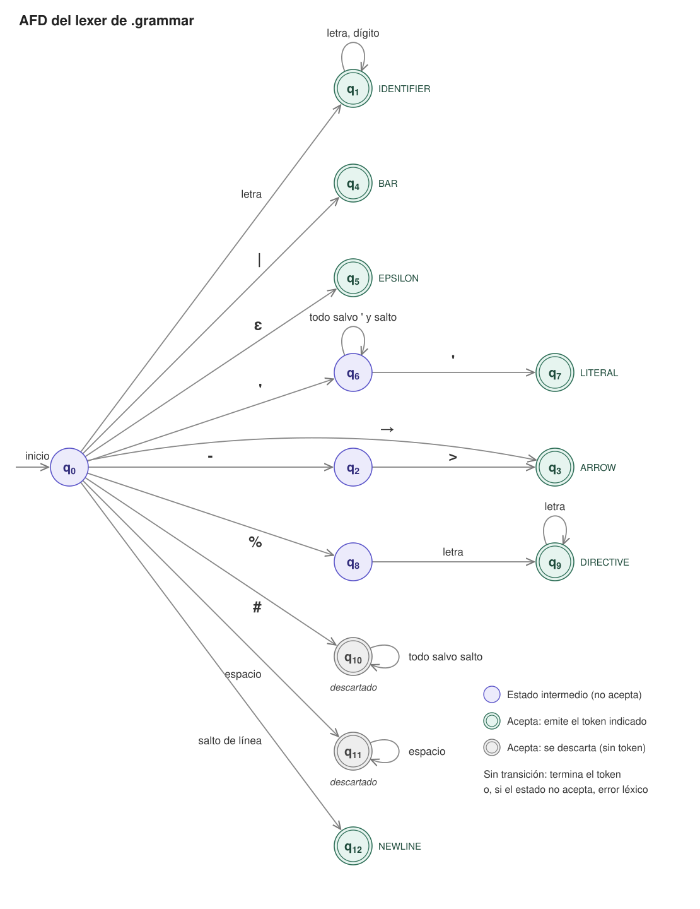

# 03 — Autómata finito determinista como lexer

> Archivos: `packages/core/src/automata/deterministic-finite-automaton.ts`, `packages/core/src/grammar-format/lexer.ts`, `packages/core/src/command-line/commands/lex.ts`, `packages/core/src/command-line/arguments.ts` y `packages/core/src/command-line/grammar-source.ts`.

## 1. Teoría

Un **autómata finito determinista** (AFD) es una 5-upla M = (Q, Σ, δ, q₀, F):

- **Q:** conjunto finito de **estados**.
- **Σ:** **alfabeto** de entrada, finito.
- **δ: Q × Σ → Q:** la **función de transición**. Para cada estado y cada símbolo hay a lo sumo un estado siguiente, y no hay transiciones ε.
- **q₀ ∈ Q:** el **estado inicial**.
- **F ⊆ Q:** los **estados de aceptación**.

M acepta una cadena w si, partiendo de q₀ y siguiendo δ símbolo por símbolo, termina en un estado de F. El lenguaje L(M) es siempre **regular**.

**Como lexer**, el AFD no decide si todo el texto pertenece a L(M): lo **corta en tokens**. Cada token se lee desde q₀ siguiendo δ **mientras haya transición** (_maximal munch_: el token más largo posible). Si se detiene en un estado de F, emite el token de ese estado, o lo descarta si es un espacio o un comentario. Si se detiene fuera de F, hay un error léxico.

### Ejemplo resuelto a mano

Un AFD de juguete para enteros separados por espacios (el de la prueba del ejecutor, sin su signo `-` opcional):

| Estado | dígito | espacio | Acepta      |
| ------ | ------ | ------- | ----------- |
| q₀     | q₁     | q₂      | no          |
| q₁     | q₁     |         | `INTEGER`   |
| q₂     |        | q₂      | se descarta |

Texto `12 345`:

| Paso | Estado | Lee           | Siguiente  | Qué pasa                                                    |
| ---- | ------ | ------------- | ---------- | ----------------------------------------------------------- |
| 1    | q₀     | `1`           | q₁         |                                                             |
| 2    | q₁     | `2`           | q₁         |                                                             |
| 3    | q₁     | ` `           | —          | no hay transición; q₁ ∈ F: emite INTEGER "12" y vuelve a q₀ |
| 4    | q₀     | ` `           | q₂         |                                                             |
| 5    | q₂     | `3`           | —          | q₂ ∈ F: se descarta el espacio                              |
| 6    | q₀     | `3`, `4`, `5` | q₁, q₁, q₁ |                                                             |
| 7    | q₁     | (fin)         | —          | emite INTEGER "345"                                         |

Resultado: `INTEGER(12) INTEGER(345)`. Por _maximal munch_, `12` es un token y no dos.

## 2. Por qué así

- **Los tokens forman un lenguaje regular.** Para saber si un carácter sigue el token o lo termina, alcanza con recordar en qué parte del token se está ("dentro de un identificador", "leí un guion, espero `>`"). Es información finita: no hace falta una pila.
- **Clases de caracteres como alfabeto.** Σ no son los caracteres sino 13 **clases** (`letter`, `digit`, `hyphen`, …). Una función fija, `classifyCharacter`, convierte cada carácter en su clase antes de consultar δ. La tabla tiene 13 columnas en vez de una por carácter, y sigue siendo un AFD.
- **El autómata es una tabla; el programa solo la recorre.** El ejecutor (`automata/`) no sabe nada del formato `.grammar` y sirve para cualquier tabla δ. El lexer (`grammar-format/`) solo aporta la tabla y qué hacer con cada token.
- **Descartadas las expresiones regulares de JavaScript:** describen lo mismo, pero esconden el autómata. No se podría mostrar δ ni seguir los estados.
- **Descartados los `if` anidados:** también serían un AFD, pero la tabla quedaría repartida en el control de flujo.
- **Descartado un parser con pila** (como el LL(1) de la [guía 04](04-parser-ll1.md)): más potente de lo necesario.
- **El lexer no sabe qué es terminal.** `CRI` y `Pistas` son los dos `IDENTIFIER`. Eso lo decide `buildGrammar` ([guía 02](02-gramatica-libre-de-contexto.md)).

## 3. El código, función por función

### 3.1 El autómata del formato `.grammar`

**Las clases de caracteres** (Σ):

| Clase            | Caracteres                                               |
| ---------------- | -------------------------------------------------------- |
| `letter`         | letras (incluidas las acentuadas) y `_`, **excepto** `ε` |
| `digit`          | `0`–`9`                                                  |
| `whitespace`     | espacio, tabulación, retorno de carro (`\r`)             |
| `lineBreak`      | salto de línea (`\n`)                                    |
| `hyphen`         | `-`                                                      |
| `greaterThan`    | `>`                                                      |
| `unicodeArrow`   | `→`                                                      |
| `verticalBar`    | `\|`                                                     |
| `epsilonSign`    | `ε`                                                      |
| `singleQuote`    | `'`                                                      |
| `hash`           | `#`                                                      |
| `percentSign`    | `%`                                                      |
| `otherCharacter` | cualquier otro carácter                                  |

- `ε` tiene su propia clase, aunque sea una letra griega. Si fuera `letter`, se leería como identificador.
- Un identificador empieza con letra y sigue con letras o dígitos (`G1`). Uno que empieza con dígito es un error.
- `\r` es espacio, para que los archivos de Windows (`\r\n`) funcionen igual.

**El grafo de estados:**



> La imagen se genera con `python3 docs/guides/images/generate-lexer-automaton.py docs/guides/images/03-lexer-automaton.svg`. Si cambia el autómata, se actualiza ese script y se vuelve a generar.

- Doble círculo: estado de aceptación. En verde emite el token indicado; en gris acepta pero se descarta (espacios y comentarios).
- Círculo simple: estado intermedio. Detenerse ahí es un error léxico.
- Sin flecha para un carácter: el autómata se detiene.

**La tabla δ.** Una celda vacía significa "no hay transición": el autómata se detiene.

| Estado                            | Acepta       | letter | digit | whitespace | lineBreak | hyphen | greaterThan | unicodeArrow | verticalBar | epsilonSign | singleQuote | hash | percentSign | otherCharacter |
| --------------------------------- | ------------ | ------ | ----- | ---------- | --------- | ------ | ----------- | ------------ | ----------- | ----------- | ----------- | ---- | ----------- | -------------- |
| **q₀** `q0Start`                  | no           | q₁     |       | q₁₁        | q₁₂       | q₂     |             | q₃           | q₄          | q₅          | q₆          | q₁₀  | q₈          |                |
| **q₁** `q1ReadingIdentifier`      | `IDENTIFIER` | q₁     | q₁    |            |           |        |             |              |             |             |             |      |             |                |
| **q₂** `q2ExpectingArrowHead`     | no           |        |       |            |           |        | q₃          |              |             |             |             |      |             |                |
| **q₃** `q3ArrowRead`              | `ARROW`      |        |       |            |           |        |             |              |             |             |             |      |             |                |
| **q₄** `q4BarRead`                | `BAR`        |        |       |            |           |        |             |              |             |             |             |      |             |                |
| **q₅** `q5EpsilonRead`            | `EPSILON`    |        |       |            |           |        |             |              |             |             |             |      |             |                |
| **q₆** `q6ReadingLiteral`         | no           | q₆     | q₆    | q₆         |           | q₆     | q₆          | q₆           | q₆          | q₆          | q₇          | q₆   | q₆          | q₆             |
| **q₇** `q7LiteralRead`            | `LITERAL`    |        |       |            |           |        |             |              |             |             |             |      |             |                |
| **q₈** `q8ExpectingDirectiveName` | no           | q₉     |       |            |           |        |             |              |             |             |             |      |             |                |
| **q₉** `q9ReadingDirective`       | `DIRECTIVE`  | q₉     |       |            |           |        |             |              |             |             |             |      |             |                |
| **q₁₀** `q10ReadingComment`       | descartado   | q₁₀    | q₁₀   | q₁₀        |           | q₁₀    | q₁₀         | q₁₀          | q₁₀         | q₁₀         | q₁₀         | q₁₀  | q₁₀         | q₁₀            |
| **q₁₁** `q11ReadingSpaces`        | descartado   |        |       | q₁₁        |           |        |             |              |             |             |             |      |             |                |
| **q₁₂** `q12NewlineRead`          | `NEWLINE`    |        |       |            |           |        |             |              |             |             |             |      |             |                |

- _Maximal munch_: `Pistas` es un identificador y no seis, porque q₁ ya acepta después de `P` pero sigue mientras lea letras. `->` es una flecha: después de `-` está en q₂ y sigue con `>`.
- **Las directivas:** q₉ acepta cualquier `%` seguido de letras (`DIRECTIVE`). Después, una tabla de palabras reservadas decide: `%start` → `START`, `%terminals` → `TERMINALS`, cualquier otra → error. Es la técnica habitual para palabras clave: el AFD reconoce la forma y la tabla decide cuál es. Deletrear las dos palabras en δ agregaría 14 estados sin enseñar nada.
- **El `NEWLINE` final:** al terminar el texto se agrega un `NEWLINE` si el último token no lo es, y siempre `END_OF_FILE`. Así el parser exige que toda regla termine en `NEWLINE`.

**Errores léxicos.** Todos lanzan `GrammarSyntaxError`, con un mensaje que empieza con la posición (`Line 1, column 6: …`):

| Mensaje                                                      | Dónde se detiene                              | Posición informada     |
| ------------------------------------------------------------ | --------------------------------------------- | ---------------------- |
| `Unterminated literal: missing the closing quote`            | q₆, ante un salto de línea o el fin del texto | la comilla de apertura |
| `Invalid character 'x'`                                      | q₀, sin transición                            | el carácter            |
| `Expected '>' after '-'`                                     | q₂, sin `>`                                   | el guion               |
| `Expected a directive name after '%'`                        | q₈, sin letra                                 | el `%`                 |
| `Unknown directive "%inicio": expected %start or %terminals` | q₉ acepta, pero la palabra no es reservada    | el `%`                 |

### 3.2 `deterministic-finite-automaton.ts`: el ejecutor genérico

```ts
interface DeterministicAutomatonDefinition<
  State extends string,
  CharacterClass extends string,
  TokenKind extends string,
> {
  initialState: State;
  classifyCharacter: (character: string) => CharacterClass;
  transitions: Record<State, Partial<Record<CharacterClass, State>>>;
  acceptingStates: Partial<Record<State, TokenKind | null>>;
}
```

- Es M = (Q, Σ, δ, q₀, F) **como datos**: `State` es Q, `CharacterClass` es Σ, `initialState` es q₀, `transitions` es δ y `acceptingStates` es F.
- `transitions` es `Partial` porque una celda puede faltar ("no hay transición").
- En `acceptingStates`, `null` significa "acepta y se descarta"; un estado que no figura (`undefined`) no acepta.
- Con los parámetros de tipo, una transición a un estado que no existe, o una clase mal escrita, no compila.

**`AutomatonEvent`** es lo que hace el autómata paso a paso: cada transición `{ from, character, to }` y cada token que termina (`accept`). El ejecutor los devuelve en una lista, y así `lex --states` funciona sin que el ejecutor sepa de la consola.

**`AutomatonStoppedError`** se lanza al detenerse fuera de F. Guarda el estado, el carácter sin transición (`undefined` si se terminó el texto), su posición (`line`, `column`) y dónde empezaba el token (`tokenLine`, `tokenColumn`). El ejecutor no sabe qué significa cada estado, así que devuelve el estado y el lexer escribe el mensaje.

#### `runDeterministicAutomaton({ automaton, text })`

```ts
const tokens: AutomatonToken<TokenKind>[] = [];
const events: AutomatonEvent<State, TokenKind>[] = [];
let cursor: Cursor = { index: 0, line: 1, column: 1 };
while (cursor.index < text.length) {
  const end = readLongestToken({ automaton, text, tokenStart: cursor });
  events.push(...end.transitions);
  const lexeme = text.slice(cursor.index, end.index);
  const kind = tokenKindOfFinalState({
    automaton,
    tokenStart: cursor,
    end,
    blockingCharacter: text[end.index],
  });
  events.push({ type: 'accept', state: end.state, text: lexeme, kind });
  if (kind !== null) {
    tokens.push({ kind, text: lexeme, line: cursor.line, column: cursor.column });
  }
  cursor = end;
}
return { tokens, events };
```

- Un AFD solo acepta o rechaza. Para usarlo como lexer se corre **una vez por token**, siempre desde q₀.
- `cursor` lleva el índice en el texto y la línea y la columna (desde 1) para los mensajes.
- `readLongestToken` devuelve `end`: dónde terminó el token, en qué estado y con qué transiciones (que se agregan a `events`).
- `text.slice(cursor.index, end.index)` es el **lexema**, el texto exacto del token.
- `text[end.index]` es el carácter que frenó al autómata; solo se usa para el mensaje de error.
- `kind === null`: acepta y se descarta. El evento `accept` se guarda igual, para que la traza muestre lo descartado.
- `cursor = end`: el próximo token empieza en el primer carácter no consumido. Nunca se retrocede.

#### `readLongestToken` (interna): el _maximal munch_

```ts
let state = automaton.initialState;
let cursor = tokenStart;
const transitions: AutomatonEvent<State, TokenKind>[] = [];
for (;;) {
  const character = text[cursor.index];
  const next =
    character === undefined
      ? undefined
      : automaton.transitions[state][automaton.classifyCharacter(character)];
  if (character === undefined || next === undefined) {
    return { ...cursor, state, transitions };
  }
  transitions.push({ type: 'transition', from: state, character, to: next });
  state = next;
  cursor = moveCursorPast({ cursor, character });
}
```

- Es δ̂, la transición extendida, aplicada al **prefijo más largo** posible del resto del texto.
- `for (;;)` no tiene condición: la única salida es el `return`, porque hay dos motivos para parar y se revisan juntos.
- Primera salida: `character === undefined`, se acabó el texto.
- Segunda salida: `next === undefined`. `next` es literalmente δ(q, clase(c)); si la celda falta, no hay transición.
- El ternario evita llamar a `classifyCharacter(undefined)`.
- Devuelve la posición del primer carácter **no** consumido y el estado alcanzado.
- No para en el primer estado de aceptación: eso es el _maximal munch_. Nunca retrocede, porque ningún token del formato lo necesita.

#### `tokenKindOfFinalState` (interna)

```ts
const kind = automaton.acceptingStates[end.state];
const consumedSomething = end.index > tokenStart.index;
if (kind === undefined || !consumedSomething) {
  throw new AutomatonStoppedError({
    state: end.state,
    character: blockingCharacter,
    line: end.line,
    column: end.column,
    tokenLine: tokenStart.line,
    tokenColumn: tokenStart.column,
  });
}
return kind;
```

- `acceptingStates[end.state]` da el tipo de token, `null` (se descarta) o `undefined` (no está en F).
- Se compara con `=== undefined` y no con `!kind`, porque `null` es una aceptación válida.
- `kind === undefined`: el token quedó a medio leer (por ejemplo, un literal sin cerrar termina en q₆).
- `!consumedSomething`: q₀ no tuvo transición para el primer carácter. En este lexer ya lo cubre el caso anterior (q₀ no está en F), pero el ejecutor sirve para cualquier tabla: si otro estado inicial aceptara, saldría un token vacío y el `while` no terminaría nunca.
- El error guarda las dos posiciones; el lexer elige cuál mostrar.

#### `moveCursorPast({ cursor, character })` (interna)

```ts
return character === '\n'
  ? { index: cursor.index + 1, line: cursor.line + 1, column: 1 }
  : { index: cursor.index + 1, line: cursor.line, column: cursor.column + 1 };
```

- El índice siempre avanza uno. Después de `'\n'` suma una línea y vuelve a la columna 1; si no, suma una columna.
- Devuelve un cursor nuevo: `tokenStart` conserva el comienzo del token mientras `cursor` avanza.

### 3.3 `lexer.ts`: la tabla y los tokens del formato

**`TokenKind`** son los terminales de `meta.grammar`, la gramática del parser: `IDENTIFIER`, `LITERAL`, `ARROW`, `BAR`, `EPSILON`, `NEWLINE`, `START`, `TERMINALS` y `END_OF_FILE`. **`GrammarSyntaxError`** es el error de un archivo mal escrito, con `line` y `column`; lo usa también el parser.

**`lexerStates`** es Q: una lista `as const` con los 13 nombres, y `LexerState` es la unión de todos ellos. Cada nombre empieza con su número del grafo y sigue un patrón: `…Reading…` tiene bucle y acepta (salvo q₆, un literal sin cerrar), `…Read` es un token completo sin salidas, `…Expecting…` es algo incompleto que no acepta. **`characterClasses`** es Σ, con el mismo patrón `as const`.

#### `classifyCharacter(character)`

```ts
export function classifyCharacter(character: string): CharacterClass {
  const special = singleCharacterClasses[character];
  if (special !== undefined) {
    return special;
  }
  if (/^\p{L}$/u.test(character)) {
    return 'letter';
  }
  return /^[0-9]$/.test(character) ? 'digit' : 'otherCharacter';
}
```

- `singleCharacterClasses` es una tabla de caracteres especiales (`' '`, `'\t'`, `'\r'`, `'\n'`, `'-'`, `'→'`, `'ε'`, `'_'`…). Se consulta **primero**.
- El orden importa por `ε`: `\p{L}` la daría por `letter`. Como la tabla especial va antes, sale `epsilonSign`.
- `'_'` está en la tabla como `letter`, porque `\p{L}` no lo incluye.
- `/^\p{L}$/u` es cualquier letra Unicode, con acentos y ñ. La bandera `u` es necesaria para `\p{…}`.
- Al final, los dígitos; todo lo demás es `otherCharacter`, sin transiciones desde q₀.

#### `everyClassExcept({ excluded, target })` (interna)

```ts
const row: Partial<Record<CharacterClass, LexerState>> = {};
for (const characterClass of characterClasses) {
  if (!excluded.includes(characterClass)) {
    row[characterClass] = target;
  }
}
return row;
```

- Arma una fila de δ que va a `target` con todas las clases salvo las excluidas.
- Recorre `characterClasses`: si se agrega una clase, la fila la incluye sola.
- Se usa en q₁₀ (todo salvo salto de línea) y q₆ (todo salvo `'` y salto de línea). En q₆ la comilla se agrega después con su propio destino: `...everyClassExcept({ excluded: ['singleQuote', 'lineBreak'], target: 'q6ReadingLiteral' }), singleQuote: 'q7LiteralRead'`.

**`grammarLexerAutomaton`** es la tabla δ de la sección 3.1 escrita como datos:

```ts
initialState: 'q0Start',
classifyCharacter,
transitions: {
  q0Start: { letter: 'q1ReadingIdentifier', hyphen: 'q2ExpectingArrowHead', unicodeArrow: 'q3ArrowRead', … },
  q1ReadingIdentifier: { letter: 'q1ReadingIdentifier', digit: 'q1ReadingIdentifier' },
  q2ExpectingArrowHead: { greaterThan: 'q3ArrowRead' },
  q3ArrowRead: {},
  …
},
acceptingStates: { q1ReadingIdentifier: 'IDENTIFIER', q3ArrowRead: 'ARROW', …, q11ReadingSpaces: null },
```

Un estado sin transiciones (`q3ArrowRead: {}`) es uno donde el token ya terminó.

#### `tokenizeGrammar(text)` y `runLexerAutomaton(text)`

```ts
export function tokenizeGrammar(text: string): Token[] {
  const tokens = runLexerAutomaton(text).tokens.map(toToken);
  return [...tokens, ...closingTokens({ text, tokens })];
}
```

La función pública: el AFD corta el texto en lexemas, `toToken` los convierte en tokens del formato y `closingTokens` agrega el cierre. La llaman `parseGrammarText` (el parser) y el comando `lex`.

```ts
try {
  return runDeterministicAutomaton({ automaton: grammarLexerAutomaton, text });
} catch (error) {
  if (error instanceof AutomatonStoppedError) {
    throw toSyntaxError(error as AutomatonStoppedError<LexerState>);
  }
  throw error;
}
```

- `runLexerAutomaton` corre el ejecutor con la tabla del formato y traduce un `AutomatonStoppedError` a `GrammarSyntaxError`.
- `as AutomatonStoppedError<LexerState>`: `instanceof` no conoce el parámetro de tipo. Es seguro, porque el autómata es `grammarLexerAutomaton`.
- `throw error`: cualquier otro error sigue de largo sin disfrazarse de error léxico.
- `lexerEvents(text)` devuelve `runLexerAutomaton(text).events`, para `lex --states`.

#### `toToken` (interna)

```ts
const position = { line: lexeme.line, column: lexeme.column };
switch (lexeme.kind) {
  case 'LITERAL':
    return { kind: 'LITERAL', text: lexeme.text.slice(1, -1), ...position };
  case 'NEWLINE':
    return { kind: 'NEWLINE', text: '', ...position };
  case 'DIRECTIVE':
    return { kind: resolveDirective(lexeme), text: lexeme.text, ...position };
  default:
    return { kind: lexeme.kind, text: lexeme.text, ...position };
}
```

- `LITERAL`: `slice(1, -1)` quita las dos comillas. `'+'` queda `+`.
- `NEWLINE`: texto vacío, porque un `\n` no se ve en una tabla.
- `DIRECTIVE`: `resolveDirective` busca la palabra en la tabla de reservadas (`START` o `TERMINALS`) o lanza `Unknown directive`.
- `default`: `IDENTIFIER`, `ARROW`, `BAR` y `EPSILON` pasan sin cambios. TypeScript sabe que acá ya no puede ser `DIRECTIVE`.

#### `closingTokens` y `endPosition` (internas)

```ts
function closingTokens({ text, tokens }: { text: string; tokens: readonly Token[] }): Token[] {
  const end = endPosition(text);
  const closing: Token[] = [];
  if (tokens.at(-1)?.kind !== 'NEWLINE') {
    closing.push({ kind: 'NEWLINE', text: '', ...end });
  }
  closing.push({ kind: 'END_OF_FILE', text: '', ...end });
  return closing;
}

function endPosition(text: string): { line: number; column: number } {
  const lines = text.split('\n');
  const lastLine = lines.at(-1) ?? '';
  return { line: lines.length, column: lastLine.length + 1 };
}
```

- El `NEWLINE` extra se agrega si el último token no es `NEWLINE`: el archivo no termina en salto, o termina en un comentario sin salto.
- Con `tokens` vacío, `tokens.at(-1)?.kind` es `undefined` y también se agrega.
- `END_OF_FILE` va siempre. Cumple el papel de `$`: el parser siempre tiene un token para mirar.
- `endPosition`: `split('\n')` da un pedazo por línea, así que `lines.length` es la última línea, y la columna es su largo más uno.
- Si el texto termina en `\n`, el último pedazo es `''`: la posición es el comienzo de una línea nueva. Por eso en `arithmetic.grammar` (5 líneas) `END_OF_FILE` está en 6:1.
- `?? ''` solo satisface a TypeScript: `split` siempre devuelve al menos un elemento.

#### `unfinishedTokenMessages` y `toSyntaxError` (internas)

```ts
const unfinishedTokenMessages: Partial<Record<LexerState, string>> = {
  q2ExpectingArrowHead: "Expected '>' after '-'",
  q6ReadingLiteral: 'Unterminated literal: missing the closing quote',
  q8ExpectingDirectiveName: "Expected a directive name after '%'",
};

function toSyntaxError(error: AutomatonStoppedError<LexerState>): GrammarSyntaxError {
  const message = unfinishedTokenMessages[error.state];
  return message === undefined
    ? new GrammarSyntaxError({
        message: `Invalid character '${error.character ?? ''}'`,
        line: error.line,
        column: error.column,
      })
    : new GrammarSyntaxError({ message, line: error.tokenLine, column: error.tokenColumn });
}
```

- `unfinishedTokenMessages` lista los estados fuera de F donde un token puede quedar a medio leer: q₂, q₆ y q₈.
- El estado donde se detuvo decide el mensaje. El ejecutor no sabe qué significa cada estado; el lexer sí.
- Si el estado está en la tabla, la posición es dónde **empezaba** el token: para un literal sin cerrar interesa la comilla que lo abrió.
- Si no está, el autómata se detuvo en q₀ sin consumir nada: el carácter mismo es inválido, y se informa su posición.
- `error.character ?? ''`: si el texto se terminó, no hay carácter que mostrar.

### 3.4 La consola

- **`arguments.ts`:** `parseArguments` separa posicionales (`arithmetic`), _flags_ (`--states`) y opciones con valor (`--grammar-file prueba.grammar`), y rechaza opciones desconocidas o sin valor.
- **`grammar-source.ts`:** `resolveGrammarSource` elige un nombre incorporado **o** `--grammar-file` (nunca los dos); `readGrammarSource` lee el texto o lanza `Cannot read the grammar file "…"`. El registro de gramáticas está en la [guía 05](05-gramaticas-del-proyecto.md).
- **`commands/lex.ts`:** imprime la tabla de tokens y, con `--states`, la traza de la primera línea con contenido (ni en blanco ni comentario). `stateName` muestra `q3` en vez de `q3ArrowRead`, y `visible` muestra el espacio como `␣` y el salto como `⏎`.
- Códigos de salida: 0 si todo va bien, 1 ante un error léxico o un archivo ilegible, 2 ante un error de uso.

## 4. Consola y pruebas

```text
$ npm run sabueso -- lex arithmetic --states
…
DFA states for line 3: E -> E '+' T | T

Lexeme  States                   Result
------  -----------------------  ----------
E       q0 ─E→ q1                IDENTIFIER
␣       q0 ─␣→ q11               discarded
->      q0 ─-→ q2 ─>→ q3         ARROW
␣       q0 ─␣→ q11               discarded
E       q0 ─E→ q1                IDENTIFIER
␣       q0 ─␣→ q11               discarded
'+'     q0 ─'→ q6 ─+→ q6 ─'→ q7  LITERAL
␣       q0 ─␣→ q11               discarded
T       q0 ─T→ q1                IDENTIFIER
␣       q0 ─␣→ q11               discarded
|       q0 ─|→ q4                BAR
␣       q0 ─␣→ q11               discarded
T       q0 ─T→ q1                IDENTIFIER
⏎       q0 ─⏎→ q12               NEWLINE
```

Cada fila se sigue sobre el grafo. Con un archivo propio: `npm run sabueso -- lex --grammar-file examples/grammars/story.grammar --states` (usa todo lo que reconoce el lexer). Con `examples/grammars/lexical-error.grammar` sale `Error: Line 4, column 6: Unterminated literal: missing the closing quote` y código 1.

- **`packages/core/test/automata/deterministic-finite-automaton.test.ts`:** el AFD de juguete del ejemplo. Verifica tokens y descarte (`12 345`), _maximal munch_ (`12345`), un estado intermedio (`-7`), líneas y columnas, texto vacío, detención en q₀ (`12a`), detención fuera de F (`3 -`) y la lista exacta de eventos.
- **`packages/core/test/grammar-format/lexer.test.ts`:** guiada por datos (`test/fixtures/lexer-cases.ts`).
  - 12 textos válidos, comparando cada token (tipo, texto, posición): `three-line example`, `unicode arrow`, `missing final line break`, `empty text`, `comments and blank lines`, `maximal munch`, `accented identifiers`, `ε is not a letter`, `literal contents` (`'->'` dentro de comillas no es flecha), `terminals directive`, `Windows line breaks` y `tabs`.
  - 8 errores, con mensaje y posición: literal sin cerrar (al final y por un salto), carácter inválido, `>` solo, identificador que empieza con dígito, guion solo, `%` sin nombre y directiva desconocida.
  - Que el código coincide con esta guía: los 13 estados en orden, F, la fila de q₀ y la clase de 18 caracteres de ejemplo. Las demás filas de δ se cubren con los casos de arriba.
- **`packages/core/test/command-line/lex.test.ts`:** `lex` con nombre o con `--grammar-file`, con y sin `--states`, el error léxico, el archivo inexistente y los errores de uso (código 2).
- **`packages/core/test/command-line/arguments.test.ts`:** `parseArguments` en cualquier orden y sus rechazos.

## 5. Referencias

- Hopcroft, Motwani y Ullman, _Introducción a la teoría de autómatas, lenguajes y computación_, sección 2.2 (autómatas finitos deterministas).
- Augusto, sección 1.3 (autómatas finitos).
- Aho, Lam, Sethi y Ullman, _Compiladores_ (2.ª ed.), secciones 3.3 y 3.6 (análisis léxico y la regla del token más largo).
