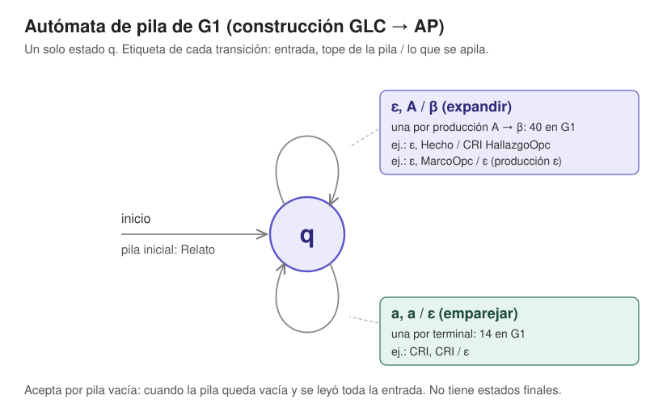

# 26 — Autómata de pila

> Archivos: `packages/core/src/pushdown-automaton/build.ts`, `packages/core/src/pushdown-automaton/simulate.ts` y el comando `packages/core/src/command-line/commands/pushdown-automaton.ts`. Página interactiva: [`docs/interactive/pushdown-automaton-g1.html`](../interactive/pushdown-automaton-g1.html).

## 1. Teoría

- Un **autómata de pila** (AP) es un autómata finito con una pila: P = (Q, Σ, Γ, δ, q₀, Z₀, F). Cada transición lee un símbolo de la entrada **o ninguno** (ε), cambia el **tope** de la pila por una cadena de Γ\* y cambia de estado. Es **no determinista**: puede haber varias transiciones posibles.
- Una **descripción instantánea** (ID) es la foto de un momento: (estado, entrada que falta leer, pila). Un paso se escribe ⊢.
- **Acepta por pila vacía:** w ∈ N(P) si (q₀, w, Z₀) ⊢\* (q, ε, ε).
- **Teorema (Hopcroft 6.3.1):** para toda GLC G hay un AP P con N(P) = L(G). Los AP reconocen exactamente los lenguajes libres de contexto.

**La construcción** usa un solo estado: P = ({q}, Σ, N ∪ Σ, δ, q, S). La pila guarda **lo que falta derivar**.

| Tipo          | Transición                           | Qué hace                                               | En G1 |
| ------------- | ------------------------------------ | ------------------------------------------------------ | ----- |
| **Expandir**  | δ(q, ε, A) ∋ (q, β) por cada A → β   | con A en el tope, lo reemplaza por β, sin leer entrada | 40    |
| **Emparejar** | δ(q, a, a) = {(q, ε)} por cada a ∈ Σ | con a en el tope y en la entrada, lo saca y avanza     | 14    |



### Ejemplo: `CRI PIS REV` con G1

El tope de la pila está a la izquierda (primeras filas; la tabla completa tiene 17 pasos: 14 expansiones y 3 emparejamientos).

| Paso | Entrada que falta | Pila                                             | Transición                                            |
| ---- | ----------------- | ------------------------------------------------ | ----------------------------------------------------- |
| 0    | CRI PIS REV       | Relato                                           | inicio                                                |
| 1    | CRI PIS REV       | Planteo Investigacion Desenlace                  | expandir (0) Relato → Planteo Investigacion Desenlace |
| 2    | CRI PIS REV       | Hecho MarcoOpc Investigacion Desenlace           | expandir (1) Planteo → Hecho MarcoOpc                 |
| 3    | CRI PIS REV       | CRI HallazgoOpc MarcoOpc Investigacion Desenlace | expandir (11) Hecho → CRI HallazgoOpc                 |
| 4    | PIS REV           | HallazgoOpc MarcoOpc Investigacion Desenlace     | emparejar CRI                                         |
| …    | …                 | …                                                | …                                                     |
| 17   | ε                 | ε                                                | expandir (33) EpiOpc → ε: **pila vacía, acepta**      |

- Las expansiones, en orden, son la **derivación más a la izquierda**: el tope es siempre el no terminal de más a la izquierda que falta derivar.
- El no determinismo está en el paso 1: `Planteo` tiene dos producciones. La rama `Marco Hecho` muere, porque `Marco` no puede empezar con `CRI`.

La [página interactiva](../interactive/pushdown-automaton-g1.html) recorre la tabla completa paso a paso.

## 2. Por qué así

- **Un solo estado, como en Hopcroft 6.3.1:** toda la información está en la pila. Con un estado alcanza para cualquier GLC.
- **Aceptación por pila vacía:** es la que da la construcción directa. La otra (por estado final) es equivalente, pero necesita estados extra.
- **Búsqueda en anchura (BFS) en lugar de adivinar:** la simulación mantiene **todas** las ramas en una cola y avanza por niveles. Así encuentra el camino de aceptación más corto.
- **Relación con Earley:** un ítem de Earley A → α • β, j es un pedazo de pila. El AP explora sus pilas una por una; Earley las comparte en el chart, y por eso es polinomial aunque la gramática sea ambigua.
- **Tres cosas hacen que termine:**
  - **visitados:** la misma configuración (posición, pila) no se explora dos veces. Corta los ciclos A ⇒+ A;
  - **poda por minYield** ([guía 08](08-longitud-minima-derivable.md)): si la pila necesita más etiquetas que las que quedan, esa rama no puede aceptar. Corta la recursión a izquierda (`E → E + T` mete un `+` en la pila cada vez);
  - **límite de pasos** (`maxSteps`, 200 000 por defecto): una pila que crece sin necesitar etiquetas (S → S B con B ⇒ ε) no se repite ni se poda; ahí la búsqueda se detiene y responde `'undetermined'`, en lugar de colgarse. No es un error, es una respuesta; con las gramáticas del proyecto no pasa.
- **El autómata es un dato** (`PushdownAutomaton`), separado de la simulación: el comando lo imprime con `--transitions`, y la web lo dibuja en la vista "Autómata de pila".
- **Un tercer reconocedor**, independiente de Earley y de CYK: la [guía 28](28-pruebas-diferenciales-y-rendimiento.md) compara los tres.

## 3. El código, función por función

### 3.1 `buildPushdownAutomaton(grammar)` (`build.ts`)

```ts
const expansions: PushdownTransition[] = grammar.productions.map((production) => ({
  kind: 'expand',
  top: production.leftSide,
  push: [...production.rightSide],
  production,
}));
const matches: PushdownTransition[] = [...grammar.terminals].map((terminal) => ({
  kind: 'match',
  terminal,
}));
return {
  state: 'q',
  inputAlphabet: new Set(grammar.terminals),
  stackAlphabet: new Set([...grammar.nonterminals, ...grammar.terminals]),
  startStack: grammar.start,
  transitions: [...expansions, ...matches],
};
```

- **`expansions`:** una transición por producción. `top` es el lado izquierdo, `push` el lado derecho (lo que queda en el tope, en orden), y `production` se guarda para mostrar su número y para comparar con la derivación.
- **`matches`:** una por terminal.
- **`stackAlphabet`:** Γ = N ∪ Σ. **`startStack`:** la pila empieza con S sola.

### 3.2 `simulatePushdownAutomaton({ grammar, tokens, maxSteps })` (`simulate.ts`)

```ts
const automaton = buildPushdownAutomaton(grammar);
const minYield = computeMinYield(grammar);
const start: SearchNode = {
  id: { position: 0, stack: [automaton.startStack] },
  via: null,
  parent: null,
};
const queue: SearchNode[] = [start];
const visited = new Set([configurationKey(start.id)]);
let steps = 0;
for (let next = 0; next < queue.length; next++) {
  if (steps >= maxSteps) {
    return { result: 'undetermined', steps, acceptingPath: null };
  }
  const node = queue[next];
  // …
  steps++;
  if (node.id.stack.length === 0 && node.id.position === tokens.length) {
    return { result: 'accept', steps, acceptingPath: pathTo(node) };
  }
  for (const successor of successors({ node, transitions: automaton.transitions, tokens })) {
    const key = configurationKey(successor.id);
    const remaining = tokens.length - successor.id.position;
    if (
      !visited.has(key) &&
      minYieldOfSequence({ symbols: successor.id.stack, minYield }) <= remaining
    ) {
      visited.add(key);
      queue.push(successor);
    }
  }
}
return { result: 'reject', steps, acceptingPath: null };
```

- **La cola es un array con un índice (`next`):** se agrega al final y se lee en orden, sin sacar elementos. Eso es BFS.
- **`SearchNode`:** la ID, la transición que la produjo (`via`) y un enlace a la ID anterior (`parent`), para reconstruir el camino.
- **`steps`:** cuántas configuraciones se sacaron de la cola. Es lo que la consola informa como "configurations explored".
- **Aceptación:** pila vacía **y** toda la entrada leída. Una pila vacía antes del final no acepta: esa rama no tiene sucesoras y muere sola.
- **El filtro antes de encolar:**
  - `configurationKey` es `'posición|pila'`; dos IDs con la misma clave son la misma configuración;
  - `minYieldOfSequence` suma el minYield de cada símbolo de la pila (un terminal cuenta 1). Si supera lo que falta leer, ninguna rama que salga de ahí puede aceptar. La función ya estaba lista desde la guía 08 para esto.
- **Los tres finales:** `accept` con su camino, `reject` si la cola se vació, `undetermined` si se llegó al límite.
- Con `CRI REV` no explora nada más que la inicial: `Relato` necesita al menos 3 etiquetas y quedan 2, así que todas las sucesoras se podan.

### 3.3 `successors({ node, transitions, tokens })`

```ts
const [top, ...rest] = node.id.stack;
if (top === undefined) {
  return [];
}
return transitions
  .filter((transition) =>
    transition.kind === 'expand'
      ? transition.top === top
      : transition.terminal === top && tokens[node.id.position] === top,
  )
  .map((transition) => ({
    id:
      transition.kind === 'expand'
        ? { position: node.id.position, stack: [...transition.push, ...rest] }
        : { position: node.id.position + 1, stack: rest },
    via: transition,
    parent: node,
  }));
```

- **`[top, ...rest]`:** el tope es el índice 0; `rest` es lo que queda debajo.
- **Pila vacía:** no hay sucesoras.
- **`filter`:** las transiciones que se pueden usar ahora: una expansión cuyo `top` coincide, o el emparejamiento del terminal del tope si la entrada sigue con él.
- **`map`:**
  - **expandir:** la posición no cambia y el tope se reemplaza por `push` (`[...transition.push, ...rest]`). Una producción ε deja solo `rest`: saca el tope;
  - **emparejar:** avanza una posición y saca el tope.

### 3.4 `pathTo(node)`

Sigue los enlaces `parent` desde la ID final hasta la inicial y los pone en orden (`unshift`). El resultado es la lista de `PathStep`: cada ID con la transición que llevó a ella (`null` en la primera).

### 3.5 El comando `pushdown-automaton`

- Rechaza primero una etiqueta fuera de Σ, sin correr el autómata, como los demás comandos.
- **`formatAutomaton`:** P = ({q}, Σ, Γ, δ, q, S) y los tamaños: en G1, |Σ| = 14, |Γ| = 35 y |δ| = 54 (40 expandir, 14 emparejar).
- **`--transitions` (`formatTransitions`):** δ, una línea por transición: `δ(q, ε, Relato) ∋ (q, Planteo Investigacion Desenlace)   (0)` o `δ(q, CRI, CRI) = {(q, ε)}`.
- **`formatResult`:** `ACCEPTED`, `REJECTED` o `UNDETERMINED`, con las configuraciones exploradas.
- **`formatPath`:** el camino como tabla: paso, entrada que falta, pila (tope a la izquierda) y transición (`expand (11) Hecho → CRI HallazgoOpc`, `match CRI`).
- Código de salida: 0 si acepta; 1 si rechaza, no se sabe o hay una etiqueta fuera de Σ; 2 si el uso es incorrecto.

## 4. Consola y pruebas

```sh
npm run sabueso -- pushdown-automaton --grammar g1 "CRI PIS REV"
```

Imprime `ACCEPTED` (23 configuraciones exploradas) y la tabla de IDs completa del ejemplo. Con `--transitions` imprime también δ. Otros casos: `"CRI SOS PIS INT REV"` (A1) y `--grammar parentheses --transitions "( ( ) ) ( )"`.

**`packages/core/test/pushdown-automaton/pushdown-automaton.test.ts`:**

| Prueba               | Qué verifica                                                                                         |
| -------------------- | ---------------------------------------------------------------------------------------------------- |
| la construcción      | G1: 40 expandir y 14 emparejar, Γ = N ∪ Σ; `parentheses` transición por transición                   |
| P1                   | `( ( ) ) ( )` y la cadena vacía se aceptan con `parentheses` (lo pide el spec)                       |
| la tabla del ejemplo | `CRI PIS REV` con G1, ID por ID                                                                      |
| AP1                  | las 18 expansiones de A1 con G1 son su derivación más a la izquierda (lo pide el spec)               |
| formas sentenciales  | lo leído más la pila es una forma de la derivación, en cada ID                                       |
| rechazo y poda       | `CRI REV` se rechaza explorando 1 configuración; el lenguaje vacío rechaza                           |
| ciclos y límite      | `test-cyclic` termina; S → S B, B → ε da `undetermined` con `maxSteps`                               |
| AP y Earley          | aceptan las mismas cadenas cortas, sin `undetermined` (G0 y G1 hasta largo 3, `parentheses` hasta 6) |

**`packages/core/test/command-line/pushdown-automaton.test.ts`:** el autómata, `ACCEPTED` y la tabla de `CRI PIS REV`; `--transitions`; el rechazo de `CRI REV`; una etiqueta fuera de Σ y los errores de uso.

## 5. Referencias

- Hopcroft, Motwani y Ullman, _Introducción a la teoría de autómatas, lenguajes y computación_, secciones 6.1 a 6.3 (en particular 6.3.1, de gramáticas a autómatas de pila).
- Augusto, secciones 2.5 y 2.6.
